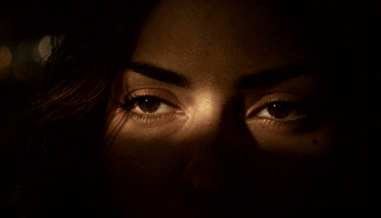
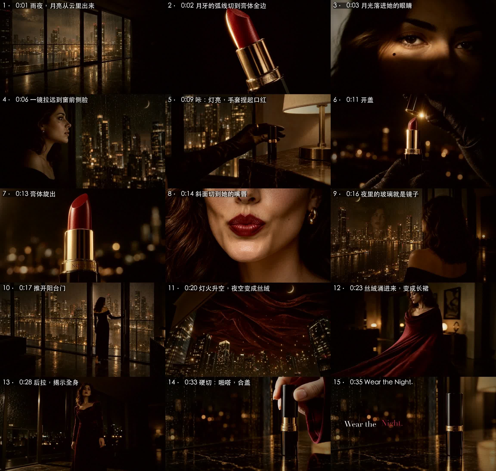
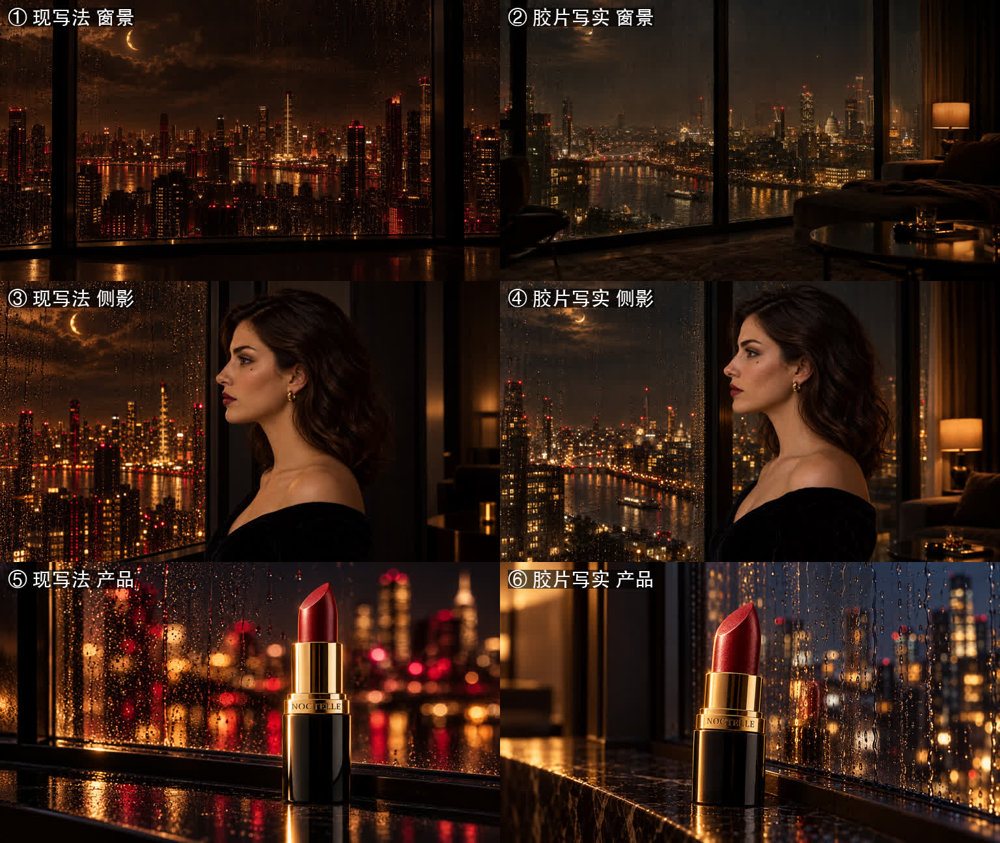

# NOCTELLE《Wear the Night.》· AI 口红广告实战案例

**AI Video Ad Case Study — a 36-second luxury lipstick commercial made with GPT Image 2.5 + MiniMax H3, every step and every revision documented**

**▶ [看完整成片（36 秒，带声音）](assets/05-video/NOCTELLE_Wear-the-Night_v4.mp4)**　·　[Codex 剪的 30 秒融合版](codex/README.md)

> 点开 MP4 会进入文件页；如果页面上没有播放器，下载下来就能看。上面的动图是 13 秒的静音精华。

一个从没做过 AI 视频的**总指挥**，加一个 **AI 导演**，从 Gemini 会员里的免费额度练手开始，做出一支虚构奢华口红品牌的完整广告。中间推翻重来过好几次，**剪辑就改了 6 版**。这个仓库把每一步做了什么、为什么这么做、哪里翻了车、后来怎么改，全都记了下来。

| | |
|---|---|
| **品牌** | NOCTELLE（虚构）· 广告语 *Wear the Night.* |
| **成片** | 36 秒 · 13 个镜头 · 1344×768 · 24fps |
| **工具** | GPT Image 2.5 出关键帧 · MiniMax H3 出视频 · ffmpeg + Python 剪辑、配乐、混音 |
| **花费** | 约 ¥54 + $3（明细见下面） |
| **用时** | 一天：从下午练手，到深夜成片 |
| **总指挥** | 尚尚（[@shangshang21](https://github.com/shangshang21)）：审美判断、方向决策、验收 |
| **导演** | Claude（Anthropic）：分镜、提示词、关键帧、剪辑、配乐、混音、文档 |
| **平行剪辑** | Codex（OpenAI）：另剪了 27 秒和 30 秒两个版本，见 [codex/](codex/README.md) |

> 所有品牌、产品和人物都是虚构的。案例里提到的第三方作品只放链接和我们自己写的分析，不转载画面。

---

## 成片，一镜一镜看

雨夜，云散开，一弯月牙露出来。月光落进她的眼睛，叫醒了她；她转头望向窗外。“咔”，台灯亮了，戴着黑缎手套的手捏起口红：开盖、旋出，嘴唇已经是酒红色。夜里的落地玻璃就是她的镜子。她推开阳台门，城市的灯火升上天空，夜空变成一整片酒红丝绒，涌进房间，在她身上收拢成一条长裙。镜头后拉到全身，然后硬切：一只手扣上盖子，“**啪嗒**”。

***Wear the Night.***

---

## 这支广告是怎么一版一版改出来的

### ① 先拿免费额度练手
算了一下 MiniMax H3 的账：每秒 ¥0.5，10 秒就是 ¥5，还不一定能用。所以先用 Gemini 会员里的免费视频拍了几条 10 秒试镜，摸清视频模型的脾气。

学到的：**一个人的微表情能演，两个人卡同一时间点的互动还不行**；不给参考图时，同一套描述给的是**“同一类型的脸”，不是同一个人**。→ [docs/01](docs/01-Gemini免费视频试镜.md)

### ② 汽水 → 口红：调性要跟着品类走
第一个创意是一瓶汽水，做到一半发现和一个标杆案例撞了。拆解完那个案例（32.6 秒切了 31 刀），总指挥拍板：

> “高端跟汽水不搭边。如果做口红的话，就要挑高端。”

于是换成口红：外国模特、英文品牌、高端路线。主视觉出了三个方向，选了 A（酒红、黑、金）：

→ [docs/02](docs/02-汽水汐-从丑到能看.md)　[docs/03](docs/03-标杆拆解-AURA-SODA.md)　[docs/04](docs/04-NOCTELLE口红-品牌模特锚定图.md)　[docs/09](docs/09-向顶奢借思路.md)

### ③ 模特三视图：先把人锁住
正面、四分之三、侧面，三张独立的图。后面每一个镜头的脸都以它为准。

### ④ 从“偏动画”到胶片写实
> 总指挥：“MiniMax 出来的东西感觉像动画，不像那种真人加特效。”

查了 GPT Image 2.5 的官方指南才发现，问题出在提示词：**cinematic、dramatic 这类词反而让画面更假**。改成真实相机的写法（35mm 胶片、真实的皮肤纹理、*no glamorization*）。左边是原写法，右边是胶片写实：

→ [docs/11](docs/11-GPT-Image-2.5写实提示词心得.md)

### ⑤ 两步法：参考图会锁死构图
带着模特参考图出图，模型会把参考图的姿势和背景整个照搬过来。解决办法是分两步：**先用纯文字出构图，再“只换脸”**。

→ [docs/12](docs/12-两步法与写实关键帧v3.md)

### ⑥ “像有两个窗户一样”：连续性检查
> 总指挥：“第 4 幕有点割裂，就像有两个窗户一样。口红应该放到卧室的灯旁边吧？”

他是用**生活常识**看片子的：这个家有没有窗台？口红该放哪？灯是谁开的？一查，问题一串：口红的位置、灯开没开、手套戴没戴、衣服换没换。全部用“只改 X”的办法修掉：

→ [docs/13](docs/13-连续性检查.md)

### ⑦ “3 到 5 之间你打算怎么处理？”：转场与运镜
> 总指挥：“不用每一张都用图片生成，但我们心里一定要知道这个运镜该怎么运。抱着这样的想法去审视每一张图片，这样才会有故事感。”

按这个思路把整条片子从头“走”了一遍，给每两镜之间都找了一个理由：形状匹配、光的接力、动作匹配、声音先进、一镜到底……

→ [docs/14](docs/14-转场与运镜设计.md)

### ⑧ MiniMax H3 出片
关键帧做好以后，用 H3 的图生视频和**首尾帧**模式出片：给一张起点、一张终点，中间的运镜交给模型。开灯捏起、灯火上摇、丝绒成裙、后拉揭示，这几条一镜到底全部一次成功。主线一共出了 19 条。

→ [docs/15](docs/15-H3出片与粗剪v1.md)

### ⑨ 剪辑：总指挥的五句话
导演看不了视频，只能一帧一帧看截图，所以每一版都靠总指挥的眼睛和耳朵。他每说一句，就是一版：

- **v1 → v2**　“拼凑感还是太严重。”
  量了才发现元凶是**声音**：各条片子的响度差了将近 50dB，每切一刀，耳朵就“咯噔”一下。每段原声淡入淡出、底下铺一条连续的雨声，响度跳变从 13 次降到 1 次。→ [docs/16](docs/16-剪辑v2-去掉拼凑感.md)
- **v2 → v3**　“3 太惊艳了，衬托得 5 就差点意思了。”“拉远到全身，然后直接切到手拿盖子盖上，啪嗒一下。”
  眼睛特写和侧脸用首尾帧合成**一镜到底**；结尾删掉回看和快闪，后拉到全身以后，硬切到一个贴近的合盖。→ [docs/17](docs/17-剪辑v3-一镜到底与收尾.md)
- **v3 → v3.1**　“11 到 12 秒的过渡，可以用剪辑的手法弥补一下吗？”
  量出手捏住口红以后，有 **1.2 秒画面一动不动**。改成动作一完成就切，再让开盖的“咔”补上中间那一拍。
- **v3.1 → v3.2**　“推进稍微再慢一些。我们的主题比较舒缓，快速推进显得着急了。”
  加速推改成**整镜匀速缓推**，出了两档速度给他挑。
- **v3.2 → v4**　“开始做配乐卡点吧。”
  开灯的“咔”是第一拍，之后**每一刀都落在半拍上**；硬切到合盖的那一下，音乐停住，“啪嗒”在安静里响。→ [docs/18](docs/18-配乐与卡点v4.md)

v3 → v3.1 改的那一刀，改后每格 1/12 秒：手指一捏住就切进微距，盖子正好离开。

---

## 最重要的 12 条经验

**出图**
1. **写实靠真实相机的写法**（胶片、焦段、真实皮肤），cinematic、dramatic 这类词反而更假。
2. **参考图会锁死构图**：先用纯文字出构图，再“只换脸 / 只换产品”。
3. **“只改 X，其他不变”是最好用的修图句式**：关灯、补手套、盖上盖子，都靠它。
4. **参考图会“串味”**：口红颜色、地标、平光都会被带进新图，要在提示词里写明不要。

**出片**

5. **首尾帧最适合一镜到底**：只给起点和终点，中间的推拉摇移交给视频模型。
6. **方向要写死**，比如“转向画面右边”。不写清楚，视线就接不上下一镜。
7. **一个人的微表情能演，两个人卡点的互动还不行**，这种戏拆成两个镜头。

**故事与剪辑**

8. **每两镜之间都要有理由**：动作、视线、光、声音、形状，至少占一样。
9. **用生活常识审片**：这个家有几扇窗？东西该放在哪？光从哪来？
10. **拼凑感的头号元凶是声音，不是画面。**
11. **动作一完成就切**。画面停住了、人还在等，就是“死时间”。
12. **运镜的速度也是调性**：舒缓的片子不要用加速推。

---

## 流程，一步一步

1. **品牌**：名字、广告语、三色色板（酒红、黑、金）
2. **锚定图**：模特三视图、产品主视觉，**每张都是独立的图**，不拼宫格
3. **分镜**：一个房间、一套衣服、一支口红（连续性）；每两镜怎么接（转场）
4. **关键帧**：GPT Image 2.5 两步法，出图后统一用“只改 X”修细节
5. **出片**：MiniMax H3，图生视频 + 首尾帧一镜到底
6. **剪辑**：ffmpeg 时间线，硬切成块、块间转场、J-cut、统一调色、连续的环境声
7. **配乐与定版**：卡点、统一三声“咔哒”、片尾出字

---

## 花了多少钱

| 项目 | 费用 |
|---|---|
| Gemini 会员视频（练手） | 会员内 |
| GPT 出图（Codex 内置版，草稿） | ChatGPT 会员内 |
| GPT Image 2.5 Sunburst（API，关键帧） | 约 $3 |
| MiniMax H3（主线 19 条，768P，¥0.5/秒） | 约 ¥44.5（按刊例价） |
| MiniMax H3（Codex 补拍近景 + 配乐素材） | 约 ¥9.5（按刊例价，逐任务实扣未核实，[明细](codex/docs/06-费用明细.md)） |
| 配乐（主线用代码合成） | ¥0 |
| **合计** | **约 ¥54 + $3** |

---

## Codex 的平行版本

同一批素材，Codex 另外剪了两版：**27 秒独立精剪 v2**，以及取用主线 v3 / v3.2 镜头的 **30 秒融合精剪 v4**。它还用 H3 补拍了一个涂口红的近景，生成了配乐素材。原始品牌、美术、分镜和主要素材来自上面的主线，Codex 新增的工作在它的展示区里分别署名。

---

## 全部文档

**前期：练手与定方向**
- [01 · 用 Gemini 免费视频练手](docs/01-Gemini免费视频试镜.md)
- [02 · 汽水广告「汐」：从“丑”到“能看”（暂停）](docs/02-汽水汐-从丑到能看.md)
- [03 · 拆解标杆案例 AURA SODA](docs/03-标杆拆解-AURA-SODA.md)
- [04 · NOCTELLE：品牌、模特、锚定图](docs/04-NOCTELLE口红-品牌模特锚定图.md)
- [05 · 生图模型对比：Codex 内置版 vs Sunburst](docs/05-生图模型对比-Codex2.5-vs-Sunburst.md)

**分镜与关键帧**
- [08 · 导演阐述与分镜 v1](docs/08-导演阐述与分镜.md)
- [09 · 向顶奢借思路（香奈儿、迪奥、爱马仕、LV、娇兰、YSL）](docs/09-向顶奢借思路.md)
- [10 · 分镜 v2：30 秒里的取舍](docs/10-分镜v2-30秒里的取舍.md)
- [11 · GPT Image 2.5 写实提示词心得](docs/11-GPT-Image-2.5写实提示词心得.md)
- [12 · 两步法与写实关键帧](docs/12-两步法与写实关键帧v3.md)
- [13 · 连续性检查](docs/13-连续性检查.md)
- [14 · 转场与运镜设计](docs/14-转场与运镜设计.md)

**出片与剪辑**
- [15 · MiniMax H3 出片与粗剪 v1](docs/15-H3出片与粗剪v1.md)
- [16 · 剪辑 v2：去掉“拼凑感”](docs/16-剪辑v2-去掉拼凑感.md)
- [17 · 剪辑 v3 / v3.1 / v3.2：一镜到底、死时间、缓推](docs/17-剪辑v3-一镜到底与收尾.md)
- [18 · 配乐与卡点 v4（定稿）](docs/18-配乐与卡点v4.md)

**一直在更新的**
- [06 · 踩坑清单](docs/06-踩坑清单.md)
- [07 · 工具说明](docs/07-工具说明.md)

## 仓库里有什么

- `docs/`：每个阶段的详细记录，按时间顺序
- `assets/`：我们自己生成的图和视频，不含任何第三方画面
- `prompts/`：所有用过的提示词（英文原文，部分附中文对照）
- `tools/`：出图、出片、审片、剪辑、配乐的小脚本
- `codex/`：Codex 的平行版本和它的过程记录

## 安全说明

- 仓库里**没有任何 API 密钥**。脚本从本机的 `~/.config/openai/` 和 `~/.config/minimax/` 读取，这些文件不在仓库里。
- `.gitignore` 排除了虚拟环境、ffmpeg 二进制、日志和任何 key 文件。

---

关键词：AI 广告片 · AI 视频广告 · AI 商业广告 · 产品广告 · 口红广告 · MiniMax H3 · 首尾帧 · GPT Image 2.5 · Sunburst · Gemini 视频 · Codex · 分镜 · 锚定图 · 两步法 · 连续性 · 转场 · 卡点 · 配乐 · 提示词 · ffmpeg

Keywords: AI commercial, AI video ad, product ad, lipstick commercial, MiniMax H3, first-last-frame video, GPT Image 2.5, storyboard, anchor frames, continuity, transitions, beat sync, prompt engineering, ffmpeg
