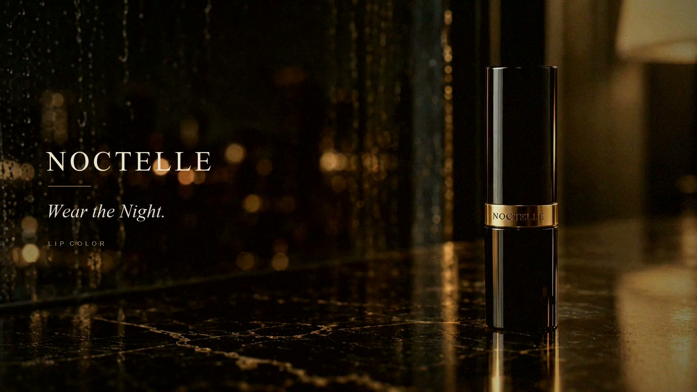
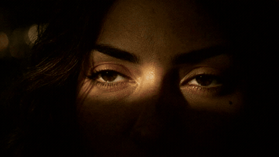
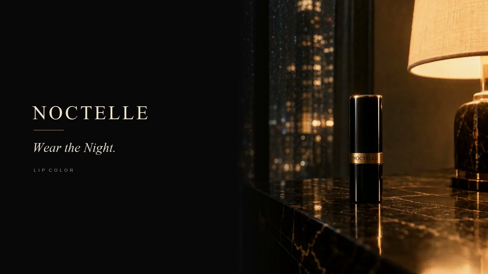

# NOCTELLE · Codex 版本展示

这里记录 Codex 接手同一批口红广告素材后的两次制作：先完成 **27 秒精剪 v2**，再取用 Claude 新版的连续运镜与合盖近景，完成 **30 秒融合精剪 v4**。

原始品牌、模特、产品、分镜与主要画面来自 [Claude 主线记录](../README.md)。Codex 的工作包括素材分析、补生成使用近景、配乐素材生成、剪辑、声音制作、片尾排版、融合与交付整理。

## 先看作品

### 30 秒融合精剪 v4

**[打开成片 MP4](assets/video/v4_30s.mp4)** · [下载完整仓库工程 ZIP（包含两版）](https://github.com/shangshang21/ai-video-ad-case-study/archive/refs/tags/codex-noctelle-2026-10-22.zip) · [镜头取用时间线](manifests/v4_timeline.csv)

下面是 **9 秒静音精选预览**，由成片的三个片段组成；完整作品为上面的 30 秒 MP4。

### 27 秒独立精剪 v2

**[打开成片 MP4](assets/video/v2_27s.mp4)** · [下载完整仓库工程 ZIP（包含两版）](https://github.com/shangshang21/ai-video-ad-case-study/archive/refs/tags/codex-noctelle-2026-10-22.zip)

| 版本 | 做了什么 | 文件规格 | 当前验收状态 |
|---|---|---|---|
| Codex v2 | 从原始粗剪重新组织动作与高潮，补上嘴近景，完成配乐和片尾 | 27 秒；1080p 导出；24 fps | 已导出并做技术检查；待人工终审 |
| Codex v4 | 融合 Claude v3 的开场、后拉与产品近景，以及 v3.2 的缓推接开盖 | 30 秒；1080p 导出；24 fps | 已导出并做技术检查；待人工终审 |

源素材是 1344 × 768。1080p 是统一画幅后的导出规格，不代表恢复了原生 1080p 细节。MP4 链接打开文件页；如页面没有播放器，可下载后观看。

## 这次融合改善了哪里

- **开场**：从眼睛特写连续转向侧脸，并逐步揭示夜景，减少独立切镜的跳变。
- **取物与开盖**：采用 Claude v3.2 的整镜缓推，保留同段开盖声。
- **结尾**：红裙后拉到全身后，直接切到贴近的产品合盖；最后稳定出字。
- **口红的作用**：保留 Codex 补生成的使用近景，让产品与后面的红色变化建立联系。

## 每一步如何完成

1. [从粗剪 v1 到 27 秒精剪：审片、判断、补镜头和剪辑](docs/01-从粗剪到27秒精剪.md)
2. [配乐、音效与片尾：接口失败后的替代路线与具体做法](docs/02-配乐音效与片尾.md)
3. [融合 Claude 最新版：实际取用、版本追踪与完整时间线](docs/03-融合Claude到30秒v4.md)
4. [工具、复现、验证和踩坑：能证明什么，还有什么没验证](docs/04-复现验证与踩坑.md)
5. [GitHub 展示与工程归档：目录、发布步骤和大包上传的处理](docs/05-GitHub展示与归档.md)
6. [费用明细：新增用量按官方刊例价约 ¥9.51，实扣口径与范围](docs/06-费用明细.md)

提示词、素材、脚本与证据也可以直接查看：

- [补镜头提示词](prompts/bridge_prompt.txt) / [配乐素材提示词](prompts/score_prompt.txt)
- [补镜头的两张参考图](assets/references/README.md)
- [H3 补镜头原始结果](assets/source/bridge_generated.mp4) / [配乐载体视频](assets/source/score_generated.mp4)
- [生成任务摘要](manifests/generation.json) / [作品与素材校验清单](manifests/artifacts.json)
- [v2 剪辑脚本](tools/render_v2.py) / [v4 融合脚本](tools/render_v4.py) / [复现入口](RENDER-v4.cmd)
- [全部工程包与校验文件](https://github.com/shangshang21/ai-video-ad-case-study/releases/tag/codex-noctelle-2026-10-22)

## 创作分工与事实边界

| 参与者 | 本次实际贡献 |
|---|---|
| 尚尚 | 提供素材、提出导演审视与剪辑需求，要求比较和融合 Claude 新版，负责最终审美判断 |
| Claude | 原始品牌与视觉体系、人物与产品锚定、主要分镜及视频；v3 连续运镜与合盖近景；v3.1 / v3.2 开盖衔接调整 |
| Codex | 审片与精剪、调用 H3 补使用近景和配乐素材、重组音轨、合成音效、片尾、版本对比与融合、脚本和过程记录 |
| MiniMax H3 | 实际生成本支线新增的近景视频和带器乐配乐的视频素材 |

这里公开的是**操作过程、设计取舍和可核查依据**。画面核查使用抽帧、联系表与关键切点的连续帧；没有冒充真人实时观看或试听。解码、帧数与响度检查通过，也不等于视觉或音乐已经通过尚尚的终审。

**新增费用按官方刊例价约 ¥9.51**：4 秒使用近景 ¥2.00，15 秒配乐载体 ¥7.50，一次 ASR 粗估约 ¥0.01。两版共用这批素材，后续融合没有再调用生成 API。本轮已查看积分账户用量，但未取得逐任务的实际人民币扣款，因此该金额标为估算。单价来源、计算过程和费用范围见 [费用明细](docs/06-费用明细.md)。

工程与文档不含 API 密钥、认证头或临时签名下载地址。
