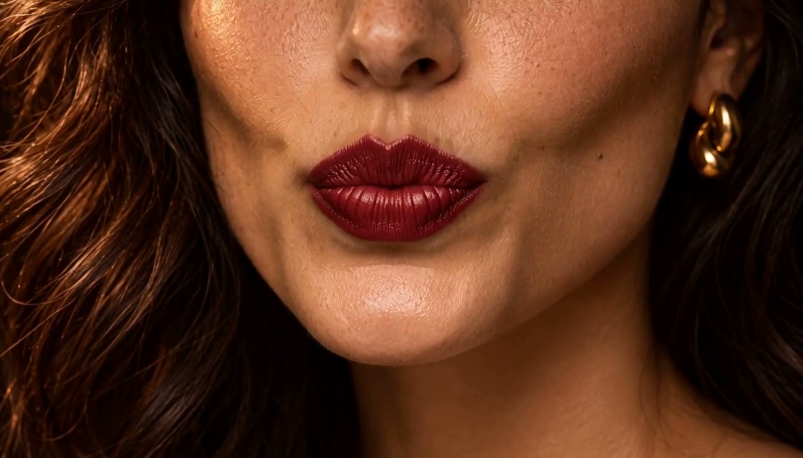
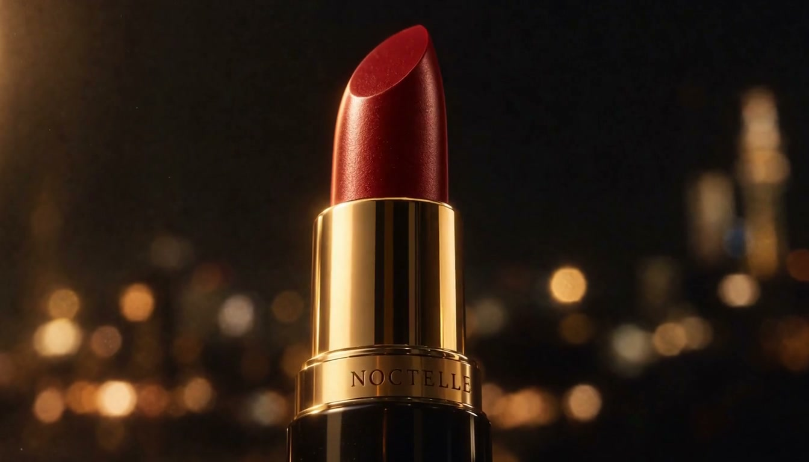

# 补镜头使用的两张参考图

两张图均从用户提供的同一条原始粗剪抽取，分别作为 H3 请求中的独立 `reference_image`。没有发送宫格图。

| 顺序 | 内容 | 原片位置 |
|---|---|---|
| 1 | 唇部、肤色与夜景灯光 | 约 13.6 秒 |
| 2 | 膏体与黑金包装 | 约 12.3 秒 |

完整请求文字见 [补镜头提示词](../../prompts/bridge_prompt.txt)。生成结果仍存在膏体形状、包装细节和唇部反光差异，参考输入没有自动保证完全一致。
