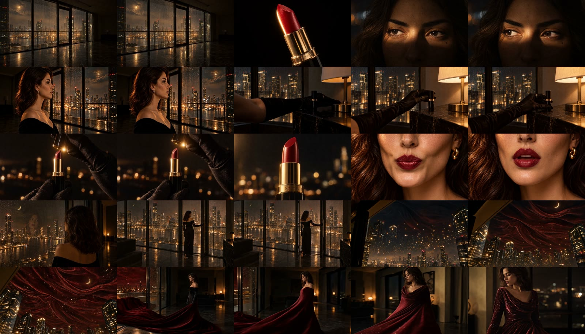
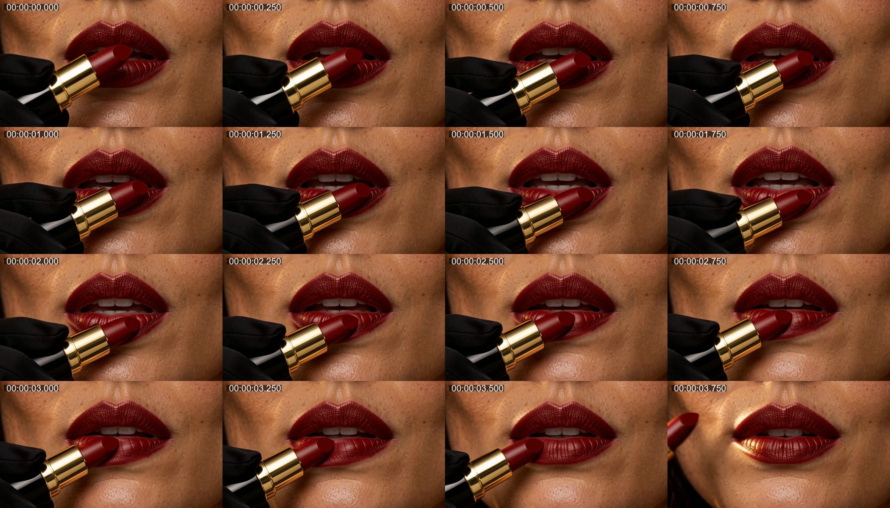

# 01 · 从粗剪到 27 秒精剪

> 2026-10-22。尚尚先提供约 35 秒粗剪，要求按广告导演、监制的视角谈思路；讨论后授权补素材并开始制作。

作品：[Codex v2 · 27 秒](../assets/video/v2_27s.mp4)。本文记录实际操作与取舍，不把最初设想写成已经完成的工作。

## 1. 先确认输入是什么

收到文件后，先用 FFprobe 读取容器和流信息，保留原文件。

| 项目 | 实际读数 |
|---|---|
| 原片 | `粗剪_全片_v1.mp4` |
| 容器时长 | 34.700 秒 |
| 视频流 | H.264；1344 × 768；813 帧；视频流时长约 34.667 秒 |
| 帧率 | 标称 24 fps；平均帧率与标称值有差别 |
| 音频流 | AAC；48 kHz；立体声 |
| 文件大小 | 11,813,738 字节 |

因此后续统一按 24 fps 和整数输出帧数排时间线，避免直接累加十进制秒数造成漂移。没有修改或覆盖原片。

## 2. 怎样看素材

操作顺序是：

1. 每秒取一帧，做全片联系表，先识别场景、人物、产品和服装的变化。
2. 再按每秒两帧取样，叠加时间码，定位每个段落。
3. 用 FFmpeg 的 `scene` 分数给切点提供线索。
4. 对取物、开盖、变装、30 秒附近的快闪和最后合盖，按更密的连续帧核看。
5. 抽取音轨并检查波形与音量；这一步只能提供声音数据，不能代替试听。

代表性命令如下，路径改为本机实际文件：

```powershell
ffprobe -v error -show_format -show_streams -of json input.mp4
ffmpeg -i input.mp4 -vf "fps=1,scale=320:-1,tile=5x5" overview_%02d.jpg
ffmpeg -i input.mp4 -vf "select='gt(scene,0.22)',showinfo" -an -f null NUL
ffmpeg -i input.mp4 -vn -af volumedetect -f null NUL
```

自动切点检测没有成为剪辑标准答案：暗场、光线变化和叠化都可能影响分数。真正的入出点还要回到连续帧和动作状态上确认。



## 3. 初次诊断与创作方向

素材中反复出现黑金夜景、红唇、城市上空的红色织物和红裙；片尾已经有 **Wear the Night.**。因此把主线整理为：

**凝视 → 选择口红 → 使用 → 红色释放 → 人物完成 → 产品收尾。**

要解决的具体问题有：

- 取口红的准备动作偏长；后续画面又已经开盖，动作的连接不够清楚。
- 产品特写后直接出现红唇，缺少一个明确的使用瞬间。
- 织物形成礼服的过程展示较完整，观众容易把注意力放在生成变化上。
- 原片约 30 秒处的快速插镜，与前面较慢的节奏差异明显。
- 最后的产品相对小，品牌主要依赖包装上的细字。

最初希望做约 26 秒版本，按整数帧整理后落在 **27 秒、648 帧**。这里的调整来自镜头取用与停留需要，没有声称 26 秒是必须遵守的投放规格。

## 4. 工具怎么选

本机已经有 FFmpeg 和 FFprobe，所以直接用它们完成剪辑、合成、编码与声音处理。没有安装 GUI 剪辑软件，也没有制作 Premiere、剪映或 Resolve 的原生工程。

`python` 命令最初指向 Windows 商店占位符，不能正常运行。随后用 `uv python list --only-installed` 找到已经安装的 Python 3.12.14，在任务目录中创建独立虚拟环境，并安装 NumPy、Pillow、SciPy、Requests、SoundFile 等需要的库。

- **FFmpeg / FFprobe**：读媒体、抽帧、裁切、变速、拼接、叠加标题、音轨处理与导出。
- **Python**：组织镜头表、调用 FFmpeg、保存时间线与校验文件。
- **NumPy / SciPy / SoundFile**：音频数组、合成纹理、混音与 WAV 输出。
- **Pillow**：联系表、透明标题图层与静态对比排版。
- **MiniMax H3**：实际生成新增使用近景和配乐载体。

## 5. 补哪一枚镜头，以及怎样补

补的是**使用口红的近景**。其任务很具体：黑手套持产品，完成下唇的一小笔，再移出画面。只需要提供足以建立使用关系的短动作。

参考图直接从原片抽取：

- 第一张：约 13.6 秒的唇部画面，用来参考肤色、唇部和灯光。
- 第二张：约 12.3 秒的膏体画面，用来参考黑金包装和红色膏体。

[查看两张参考图](../assets/references/README.md)。两张图作为独立 `reference_image` 输入，未拼成宫格。

实际调用 MiniMax H3 的参考生视频接口，提交 4 秒、768P、16:9 请求，收到任务 ID，随后轮询到 `succeeded`，下载视频并再次用 FFprobe 和连续抽帧核查。完整提示词保存在 [bridge_prompt.txt](../prompts/bridge_prompt.txt)。

新增视频流实际约 **4.458 秒**；生成任务摘要中的请求和计量仍为 4 秒。请求秒数与媒体容器时长没有混为同一个数。

生成结果也有缺点：膏体形状偏钝，包装局部和原片不完全一致；唇部反光较明显。这些差异没有因任务成功就被视为已解决。

最终取源视频 **1.50–4.25 秒**，将这 2.75 秒整理成成片的 **2.00 秒**。原声没有直接采用，放在开盖、膏体特写之后，用于建立动作关系。



## 6. v2 如何组织时间线

v2 共 19 段，详见 [机器可读镜头表](../manifests/v2_timeline.json)。几个关键段落：

| 成片位置 | 内容与取舍 |
|---|---|
| 0–4.25 秒 | 夜景、眼睛、产品预告、侧脸，建立视觉世界 |
| 4.25–7.50 秒 | 压短取物，接开盖和膏体 |
| 7.50–9.50 秒 | 新增使用近景 |
| 9.50–14.00 秒 | 倒影、面向城市、红色夜空，逐步扩大空间 |
| 14.00–18.00 秒 | 压缩织物成裙，接红裙全景 |
| 18.00–21.00 秒 | 人物、唇部与产品回响；后续融合版取消了这一组收尾插镜 |
| 21.00–27.00 秒 | 合盖与品牌定版，其中最后 3.5 秒稳定停留 |

每个片段先渲染成固定帧数的独立文件，再使用 concat 合并。变速通过时间戳重映射后统一输出 24 fps；没有使用生成式补帧或光流重建。

画面统一裁成 16:9 并导出 1920 × 1080。颜色只做轻微处理：原片小幅降饱和和加对比；新增近景略压亮度和饱和度。这些是后期匹配尝试，没有真实色号参考支撑“颜色已经准确还原”的结论。

## 7. 这版完成了什么，后来又改了什么

v2 把产品使用动作、音乐和品牌停留补进了结构；独立开场切镜和最后的人物、唇部、产品回响仍有继续调整的空间。

在后续比较 Claude 新版后，Codex 采用了连续开场、完整后拉和更近的合盖素材，形成 [30 秒融合版 v4](03-融合Claude到30秒v4.md)。v2 保留，作为第一轮判断和执行的真实记录。
