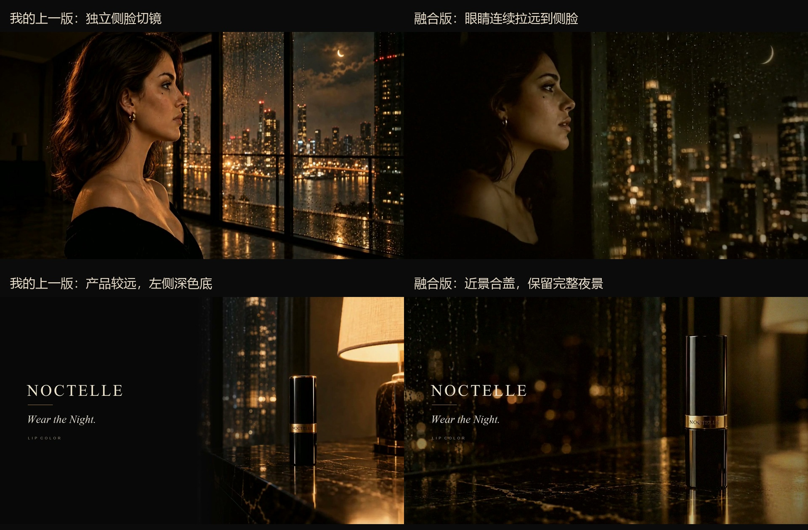
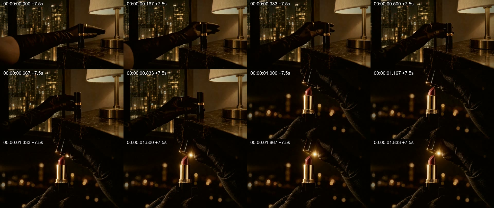

# 03 · 比较 Claude 最新版，融合成 30 秒 v4

> 尚尚的要求：到私有仓库看 Claude 刚上传的最新版，比较两个版本，取用能让画面更好的素材。制作过程中仓库继续更新，因此保留每次核对的提交，而不是只凭文件名写“最新版”。

成片：[Codex v4 · 30 秒](../assets/video/v4_30s.mp4)。

## 1. 怎样找到和确认版本

先通过 GitHub 连接器列出可访问仓库，定位到 `shangshang21/ai-video-ad-case-study`，确认它仍是私有仓库，默认分支为 `main`。随后读取最新提交、README、`docs/17` 和剪辑脚本，了解改动与尚尚此前的意见。

视频二进制与 Git 历史通过本机 GitHub CLI、Git 和 GitHub API 下载到任务的隔离目录。没有在未知本地工程上直接执行覆盖，也没有运行 Claude 的生成脚本。

| 本轮核对的提交 | 北京时间 | 主要变化 |
|---|---|---|
| `24659f4` | 2026-10-22 20:38:45 | v3：眼睛到侧脸合为连续镜头，新合盖近景；全身后拉直接接合盖 |
| `7cb505e` | 2026-10-22 20:47:23 | v3.1：缩掉捏住后的等待，加速推近接开盖，并补回开盖声音 |
| `bc66f32` | 2026-10-22 20:53:57 | v3.2：把加速推进改为整镜缓推，幅度约 1.22 倍 |

> 注：上表的提交号都是仓库公开之前的。公开时为了去掉私人内容，整个历史压成了一个提交，所以这些提交号在公开仓库里查不到；它们对应的文件内容都还在。

**融合版取材锁定在 `bc66f32`。** 这是本轮实际检查并吸收的版本；将来仓库继续更新时，本记录仍指向这次制作使用的素材。

## 2. 怎样比较，而不是直接整片替换

对 Claude 视频进行 FFprobe 读取、全片每秒两帧联系表、切点提示与重点连续帧核查，再与已有 27 秒版比较。关注四个问题：

1. 前后景别是否由动作和摄影机运动连接。
2. 人物、服装、产品和空间能否连续辨认。
3. 新镜头是否帮助口红成为叙事的触发点。
4. 收尾是否把注意力交回产品。

具体判断是：

- Claude 的连续开场值得采用。转头、后拉与夜景揭示发生在同一镜头里，减少了独立切镜的跳变。
- Claude 新的产品近景更适合合盖收尾。产品更大，手部动作更清楚。
- Claude 的完整后拉值得保留，能交代红裙与空间；原 27 秒版对此压得偏短。
- 最新缓推比加速推更接近尚尚已明确提出的舒缓调性，因此采用 v3.2 的修正。
- Codex 补的使用近景仍有结构作用，配乐来源也可以继续使用。

这张静态图用于比较具体帧的构图、产品大小与背景；运镜连续性还需要结合视频和剪辑时间线判断。

## 3. 实际取了哪些源文件

| 来源 | 本轮取用 |
|---|---|
| 原始 `粗剪_全片_v1.mp4` | 夜景、膏体、倒影、面向城市、红色夜空等 |
| Claude `粗剪_全片_v3.mp4` | 新的眼睛到侧脸连续运镜、成裙与完整后拉、新合盖近景 |
| Claude `粗剪_全片_v3.2.mp4` | 最新缓推接开盖段落及同段声音 |
| Codex `bridge_generated.mp4` | 上一轮 H3 补生成的使用口红近景 |
| Codex `score_generated.mp4` | 上一轮 H3 配乐载体，只取音频 |

Claude v3 文件仍在锁定提交的目录中，其新增运镜与近景也被后续版本沿用。这里按实际取用的文件记来源，没有把所有片段统称为“由 Codex 生成”。

仓库没有提供这些新分镜的原始视频单条文件，因此本轮从已经调色、压缩的完整视频中取用。轻度去噪和亮度匹配只能缓和差异，无法撤回已有颗粒与压缩痕迹。

## 4. 30 秒时间线

| 成片时间 | 内容 | 主要来源 |
|---|---|---|
| 0.00–1.25 | 夜景 | 原始粗剪 |
| 1.25–2.00 | 产品预告 | 原始粗剪 |
| 2.00–7.25 | 睁眼、转头、连续拉远到侧脸 | Claude v3 |
| 7.25–9.50 | 捏起、缓推、接开盖 | Claude v3.2 |
| 9.50–10.50 | 膏体 | 原始粗剪 |
| 10.50–12.50 | 使用口红近景 | Codex / H3 补镜头 |
| 12.50–13.50 | 倒影 | 原始粗剪 |
| 13.50–14.50 | 面向城市 | 原始粗剪 |
| 14.50–17.00 | 红色漫过夜空 | 原始粗剪 |
| 17.00–18.75 | 成裙过程压缩 | Claude v3 |
| 18.75–23.25 | 连续后拉到全身 | Claude v3 |
| 23.25–27.00 | 直接硬切产品近景，完成合盖 | Claude v3 |
| 27.00–30.00 | 产品停留，品牌出字 | Claude v3 背景与产品 / Codex 图层 |

完整源入点、取用长度与输出帧数见 [CSV 时间线](../manifests/v4_timeline.csv) 和 [JSON 镜头表](../manifests/v4_timeline.json)。

## 5. 哪些变化是有意的

v4 从 27 秒回到 30 秒，原因是给开场连续运镜与完整后拉更多停留时间。红色成裙的中间过程仍做压缩，避免所有段落都按同一种速度展开。

结尾取消上一版的人物回看、唇部和膏体回响，采用尚尚在 Claude 主线中已提出的“全身后拉 → 直接合盖近景”。没有把已明确删掉的插镜再次塞回结尾。

取材期间 v3.1、v3.2 陆续出现。v3.2 只改变缓推段落时，只重渲染发生变化的段落，再拼接并重新混音；其他已经完成、未受影响的镜头保留。最终公开的完整脚本仍能从源文件重建全片。

## 6. 验证与保留

- 成片为 30.000 秒、720 帧，音频同长，完整解码无报错。
- 检查了缓推接开盖、成裙接后拉、全身接近景、片尾覆盖旧文案等关键切点。
- v2 文件保留，SHA-256 与上一轮交付一致。
- 融合阶段没有新建 H3 生成任务。
- 当时的融合交付只写到本地；本展示区是在尚尚随后明确要求上传过程与作品后新增。

视觉与听感仍标注待人工终审，不把技术验证改写成审美通过。
