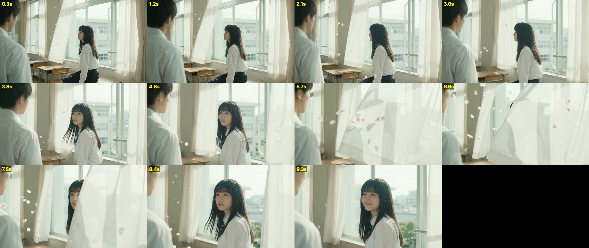
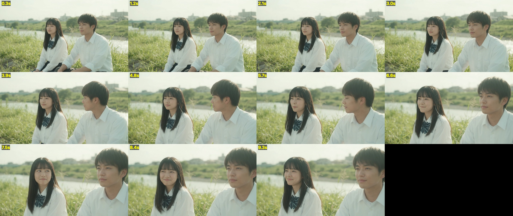

# 01 · 用 Gemini 免费视频练手：10 秒试镜

> 日期：2026-10-22 下午
> 工具：Gemini App（Pro 会员）自带的视频生成，一次最多 10 秒，输出 1280×720、24fps，带声音

## 起因

身边做电商运营的朋友想看看 AI 广告能做到什么程度。我们先算了 MiniMax H3 官方 API 的账：768P 每秒 ¥0.5，10 秒就是 ¥5，还不一定能用。所以第一步决定**先拿会员里的免费额度练手**，摸清视频模型的脾气，再花钱。

## 试镜 1：《窗帘》（岩井俊二式日系青春）

**想法**：毕业那天的空教室，逆光、过曝、纱帘、樱花瓣。镜头从男生的肩膀后面看她；风吹起纱帘遮住她的脸，纱帘落下时，她含着泪在笑。**全程不说话**：一来岩井的人物从不把话说出口，二来 Gemini 一遇到台词就容易出乱码字幕和口音问题，不说话正好绕开。

**提示词**：[窗帘_v1.txt](../prompts/01-gemini/窗帘_v1.txt)（附 [中文对照](../prompts/01-gemini/窗帘_v1_中文对照.txt)）

**成片**：[窗帘_v1.mp4](../assets/01-gemini/窗帘_v1.mp4)

**做到了**：微微过曝的通透感、纱帘的质感、樱花瓣都拍得很好；4 秒那次对视，眼神是“有对象的”。

**翻车了**
- **结尾生硬**：8.5 秒还是平静的脸，9.5 秒一下子变成咧嘴大笑，泪光完全没有。“又高兴又难过”被简化成了单纯的开心
- 原因是**提示词里先写了 smile，后写了 tears**，模型抓住第一个具体动作就去演了
- 它把纱帘当成转场，趁着遮挡偷偷换了窗外的楼和她的位置

**改法**（[窗帘_v2.txt](../prompts/01-gemini/窗帘_v2.txt)）：按“先哭后笑”的顺序写；写明 *closed-lips smile, barely a smile, not a big grin*；给最后的表情留出 3.5 秒；加一句“同一扇窗、同一个位置不许变”。

## 试镜 2：《耳机》

**想法**：傍晚的河堤，两个人共用一副有线耳机。他偷看她，她发现了却不转头，嘴角压不住地往上翘，最后她偷看回去，视线一碰两人同时躲开。专门考**两个人的对手戏**。

**提示词**：[耳机.txt](../prompts/01-gemini/耳机.txt)（附中文对照和小词表）

**成片**：[耳机_v1.mp4](../assets/01-gemini/耳机_v1.mp4)

**做到了**：8 秒那一下，她斜眼偷看、抿嘴憋笑，是试镜里演得最好的一帧：

**翻车了**：“对视后同时躲开”没有拍出来。她偷看他的时候，他正看着前面。**一个人的微表情能演，两个人卡准同一时间点的互动还不行。**

## 试镜之后的发现

### 同一套描述 ≠ 同一个人
把《窗帘》和《耳机》里的女生并排放在一起：

左边两张是窗帘，右边两张是耳机。乍一看像，其实**是同一类型，不是同一个人**：窗帘那个脸更圆、眼睛小、鼻子宽；耳机那个脸更瘦、眼睛更大。窗帘那条自己前后也不一样，脸越变越圆。所以单场景的短片不用做人物卡，**连续剧情的主角必须用参考图锁住**。

### 没有一条有硬切
用 ffmpeg 测了场景切换分数，最高值都不到 0.03，全是一镜到底。看起来像“切了一刀”的地方，其实是一次很快的推近：Gemini 好像习惯在 3 到 4 秒突然推一下镜头。

### 两条片子里有一段一模一样的声音
《窗帘》和《耳机》7.25–9.75 秒那段声音，互相关系数 **0.989**，主频都在 370Hz 左右。两段提示词都要了“一段旋律”，看起来是同一段现成音乐被插了进去，而不是现场生成的。猜测：聊天端是“试用装”，会省算力。

### Whisper 的幻觉
没有人声的《窗帘》，Whisper 转写出来是“请不吝点赞 订阅 转发 打赏支持明镜与点点栏目”。这是它出了名的毛病：遇到没人说话的音频，会编一句视频结尾常见的话。转写之前要先看 `no_speech` 概率，或者加 VAD。

### 额度
几条试镜加上聊天，用掉了当前窗口额度的 83% 和每周额度的 15%。粗算一周能拍 20 条左右，免费额度适合当练兵场。
