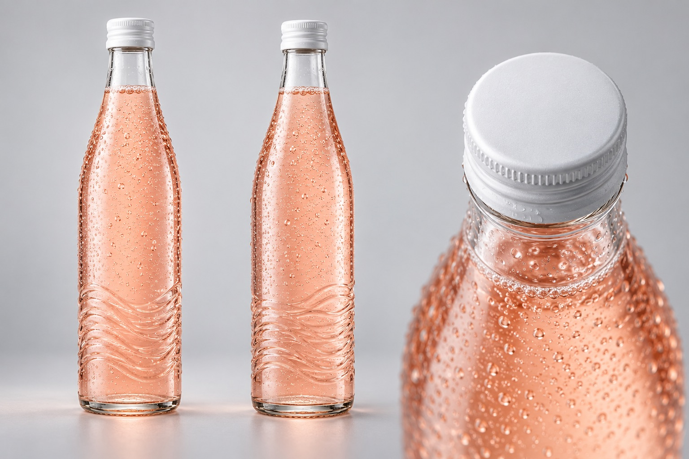
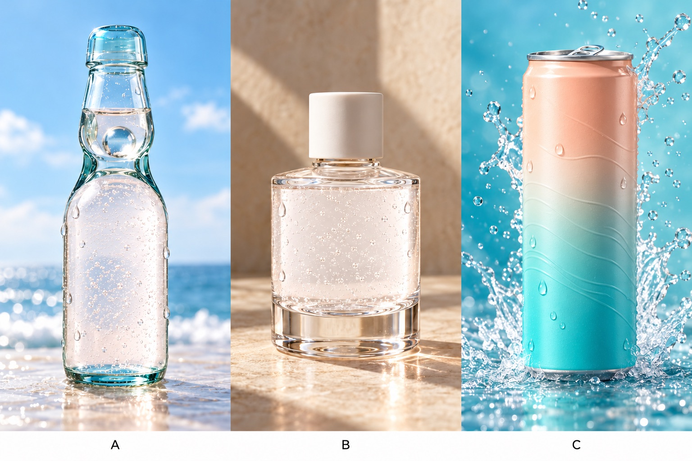
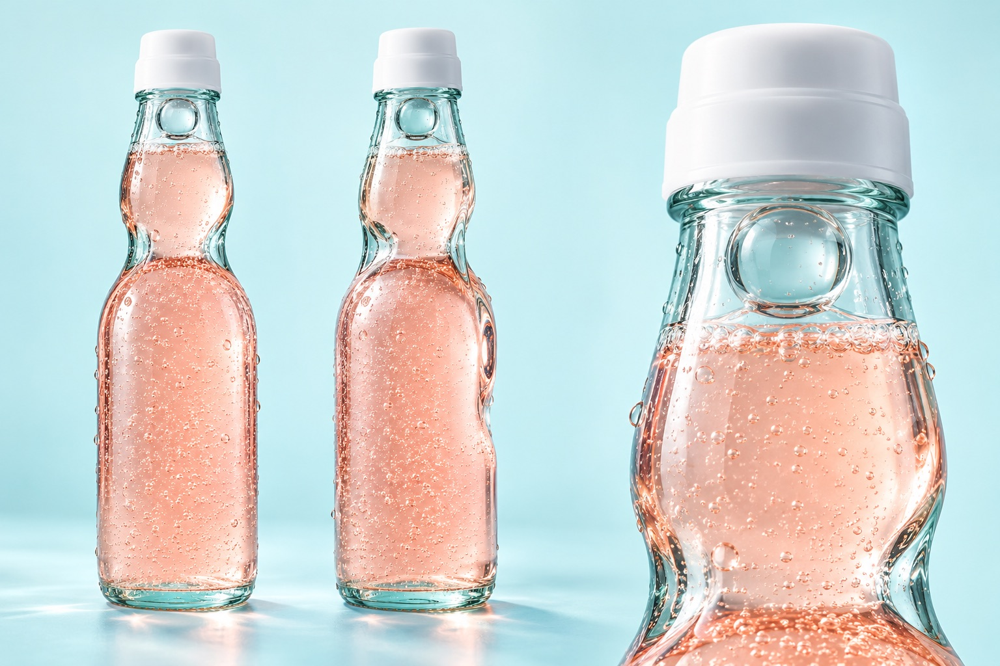
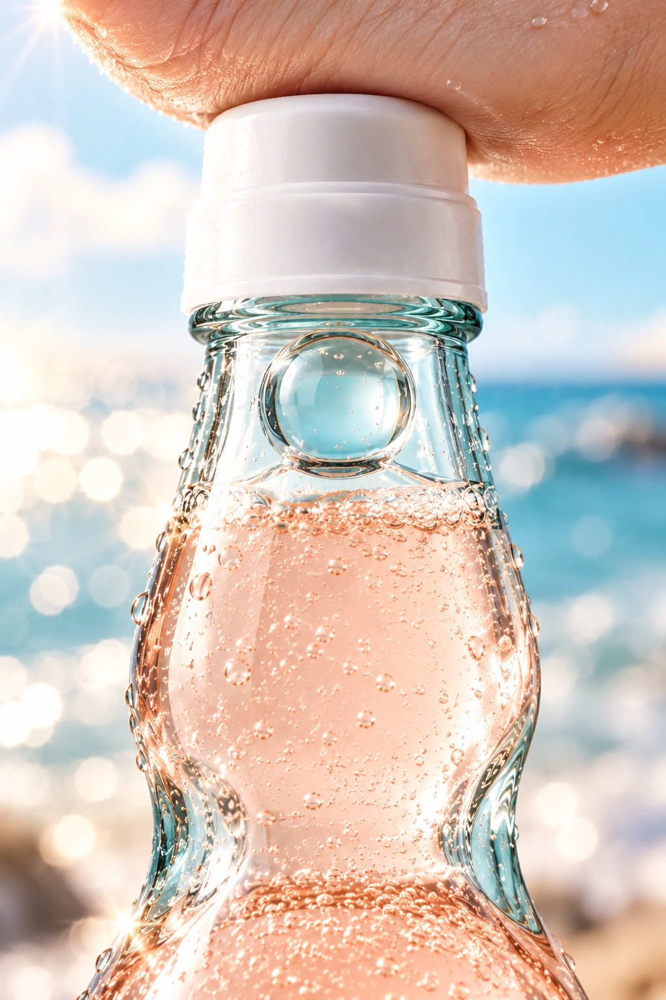

# 02 · 汽水广告「汐」：从“丑”到“能看”

> 状态：暂停。创意做到一半，我们找到了标杆案例 AURA SODA（见 [03](03-标杆拆解-AURA-SODA.md)），发现它也是汽水，就改拍口红了。这一章留下来，是因为它踩的坑最多。

## 方向选择

先列了三个虚构产品：🅰️ 汽水「汐」白桃气泡水，🅱️ 口红，🅲️ 香水。选汽水的理由是：液体、光、气泡、慢动作是 AI 视频最擅长的；不用拍人脸；产品是一个瓶子，最容易保持一致。

广告语暂定：**把夏天，关进瓶子里。**

## 第一版产品卡：被一眼看出“丑”

导演当时说“拿来做 demo 够用了”，其实是想省一次生图额度。总指挥一句“你不觉得这个汽水有点丑吗🤣”，就把问题点破了：
- 瓶型像超市里的果汁瓶，没有辨识度
- 液体是三文鱼粉，像药水，不像白桃
- 满瓶细密均匀的小水珠，看着像起了鸡皮疙瘩
- 灰色棚拍背景就是电商白底图的感觉

**教训：不要为了省一点便宜的额度，就把丑东西交出去。** 后来这成了我们的一条规矩：导演自己看着丑，就直接重画，或者出 2–3 个方向让总指挥挑。

## 三个方向

- **A 日系弹珠汽水**：带弯腰的淡青色玻璃瓶，瓶颈里卡着一颗弹珠
- **B 极简奢华**：矮胖的厚玻璃瓶配瓷白盖子，结果**活像一瓶化妆水**
- **C 活力渐变铝罐**：桃粉渐变到海青色

总指挥只看文字描述就判断：**“高端跟汽水不搭边，做口红的话才挑高端。”** B 的出图当场印证了这句话。最后定了 A：它有故事，“汐”是潮水的意思，青色玻璃像一块海玻璃，弹珠像封在瓶里的一滴海；开瓶时那一声“啵”，就是最好的开头钩子。

## 分镜 v2：商业广告的因果链

总指挥总结出商业广告的逻辑：**“啵”一下 → 弹珠落下 → 海浪升起 → 转场**。导演把它展开成六个镜头，加了一个首尾呼应：**“啵”开场，“叮”收尾**（弹珠在瓶颈里碰玻璃的声音，当作品牌的声音记忆点）。

完整分镜：[prompts/02-soda/分镜表_v2.md](../prompts/02-soda/分镜表_v2.md)

这条链管用，是因为**每个镜头都是上一个镜头动作的结果**。观众的眼睛被因果一路牵着走，不会觉得是一堆漂亮镜头的拼盘。

## 产品卡 v2 和第 1 镜首帧

| 产品卡 A v2 | 第 1 镜首帧（竖屏） |
|---|---|
|  |  |

产品卡 v2 的毛病：液体又跑回了珊瑚粉，侧面那个视角的瓶身有点歪。另外，**把三个视角拼在一张图里的“产品卡”，后来才知道是错的**，见 [04](04-NOCTELLE口红-品牌模特锚定图.md)。

首帧是按产品卡画的，单独提示把液体调淡，这次是真正的白桃粉。第 1 镜的提示词：[第1镜.txt](../prompts/02-soda/第1镜.txt)

## 为什么暂停
总指挥在 B 站找到了 AURA SODA，一支质量高得多的 AI 汽水广告，用的流程跟我们规划的几乎一样。与其做一个“低配版”，不如换个品类，把学到的东西用在口红上。
