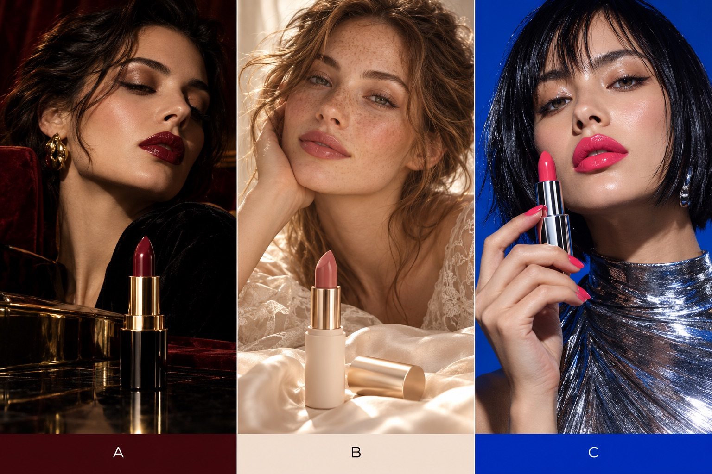
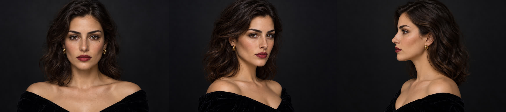
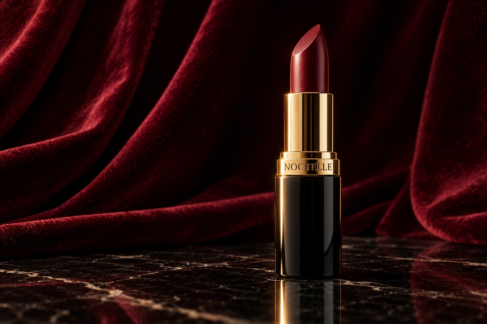
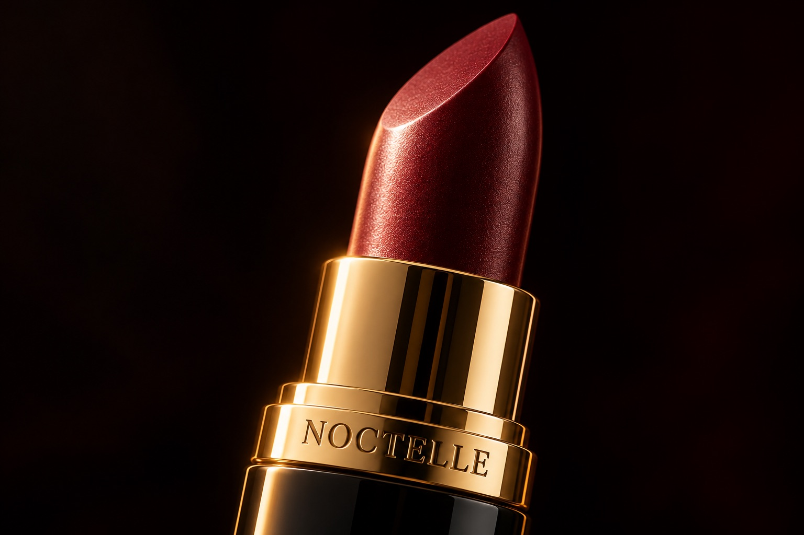
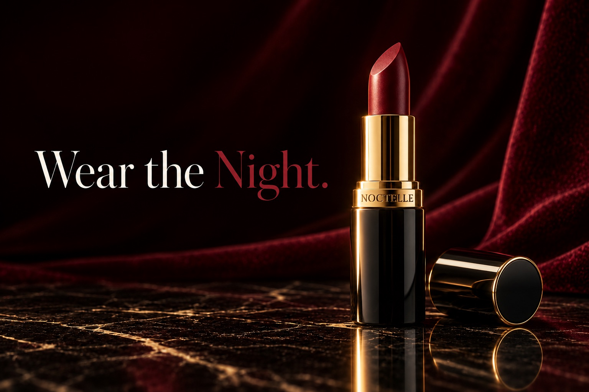
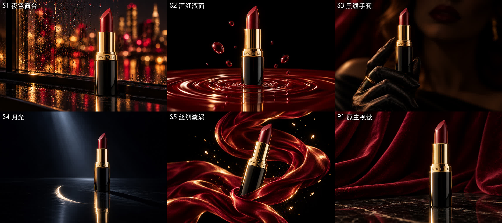

# 04 · 口红广告 NOCTELLE：品牌、模特、锚定图

> 状态：已完成。这里记录的是最早一轮的品牌、模特和锚定图；之后的分镜、写实关键帧、出片和剪辑见 [08](08-导演阐述与分镜.md) 到 [18](18-配乐与卡点v4.md)。

## 为什么换成口红
汽水的创意和 AURA SODA 撞了，而且总指挥判断“口红才该走高端”。新的要求：30 多秒、外国模特、英文品牌、高端路线，正片用 MiniMax H3。

## 主视觉三个方向

- **A 暗调奢华**（酒红、黑、金）：一眼就是大牌口红；暗场景也能藏住 AI 的瑕疵 → **选定**
- **B 晨光裸粉**（裸粉、奶油、香槟金）：最真实，但节奏太慢，不适合 1 秒一刀的快切
- **C 电光杂志风**（钴蓝、玫红、镜面银）：最有活力，但口红画成了正粉色，皮肤油光太重，AI 味明显

## 找到官方轮子：MiniMax H3 skills
AURA 的作者说“提示词交给官方的提示词 skill”。我们在 MiniMax 的 GitHub 仓库里找到了它：
https://github.com/MiniMax-AI/MiniMax-H3/tree/main/skills

一共 9 个 skill：1 个通用的写提示词 skill `h3-prompt-writing`，加 8 个风格 skill，其中 `minimalist-product-ad-generator`（极简产品广告）跟我们要做的最接近。读完以后，学到这几条硬规矩：

- **锚定图要三张独立的照片**：① 主视觉，② 材质或机制，③ 结尾文案。**不要拼成三宫格、四宫格**，视频模型会把宫格版式带进画面。我们之前做的“三视角产品卡”就踩了这个坑。
- **节拍表**：10 秒放 5–7 拍，15 秒放 6–9 拍；**每拍只有一个主要动作**。
- **H3 一条视频里就能切多个镜头**，写法是 `[Shot 2] At 00:01.500, ...`。
- **字只给一行，两种颜色**，可以让 H3 直接在视频里写出来；字幕位置不要放在最下面。
- **参考生视频（Ref2VA）的提示词分六段**：`subject_definitions` → `summary` → `retention_analysis` → `detailed_description`（350–500 词）→ `overall_soundscape` → `non_diegetic_music`。参考图用 `<Picture N>`、`<Subject N>` 标注。
- **配乐**用 MiniMax 自家的 music 模型，最后卡点剪辑。

**预算也因此改了**：原来以为 30 个镜头要生成 30 次，一轮 ¥60、抽三次 ¥120–180。实际上一条 15 秒里就能切 6–9 个镜头，30 秒只要 2–3 条，**一轮约 ¥22，抽三次约 ¥70**。总指挥最开始估的“七八十块”是对的。

## 品牌和广告语
- **NOCTELLE**：NOCT-（夜）加 -elle（法语里优雅的阴性词尾）。2026-10-22 查过，没有同名的美妆品牌。另一个候选 Vesperine 因为跟已注册的化妆品商标 VESPERA 太像，放弃了。
- **广告语：Wear the Night.** 按官方规矩只写一行、两种颜色：“Wear the”用白色，“Night.”用酒红色。

## 模特三视图（三张独立的图）

虚构的欧洲女性：深棕色波浪发，橄榄色皮肤，黑丝绒露肩上衣，金耳环。**左眼下面有一颗小痣，是专门设计的“认人标记”**，以后每个镜头都靠它核对是不是同一个人。参考图用的是均匀的光，方便锁住长相；明暗强烈的戏剧光留给视频。三张都是同一个人，痣三张都在。

先画正面，再把正面当参考图，画四分之三侧面和纯侧面。

## 产品锚定图

| P1 主视觉 | P2 材质机制 | P3 结尾文案 |
|---|---|---|
|  |  |  |

- 三张图里管身一致，金色腰线上的 NOCTELLE 刻字一个字母都没错
- P3 的“Wear the Night.”，字和双色都对，是最出彩的一张
- P1 光太均匀、构图太居中，像商品目录里的图。总指挥的评价是“还可以，但差点意思；放在幕布前也行，但想多看看别的”

## 五个备选场景

| 场景 | 导演打分 | 说明 |
|---|---|---|
| S1 夜色窗台 | 9 | 雨夜城市的灯光虚化，最扣“Wear the Night” |
| S2 酒红液面 | 9 | 涟漪和液滴，动起来最适合 AI 视频 |
| S3 黑缎手套 | 7 → **总指挥最喜欢** | 导演嫌手势别扭；总指挥看中的是质感 |
| S4 月光 | 6.5 | 太暗太空，冷银色也破坏了三色规矩 |
| S5 丝绸漩涡 | 8.5 | 动感强，适合放在高潮 |

**审美上的一课**：导演因为手势这个技术瑕疵，给 S3 打了低分；总指挥一眼看中的却是它的质感：黑缎的光泽、金戒指、背景里虚化的酒红嘴唇，这种“有人的温度”比纯产品的 CG 场景更打动人。**技术瑕疵能修，第一眼的气质才最要紧。**

S3 后来用 Sunburst 又做了几个版本，见 [05](05-生图模型对比-Codex2.5-vs-Sunburst.md)。

## 提示词
全部在 [prompts/04-lipstick/](../prompts/04-lipstick/)。所有提示词都用英文写（模型理解得更准），每张图单独一个文件。
