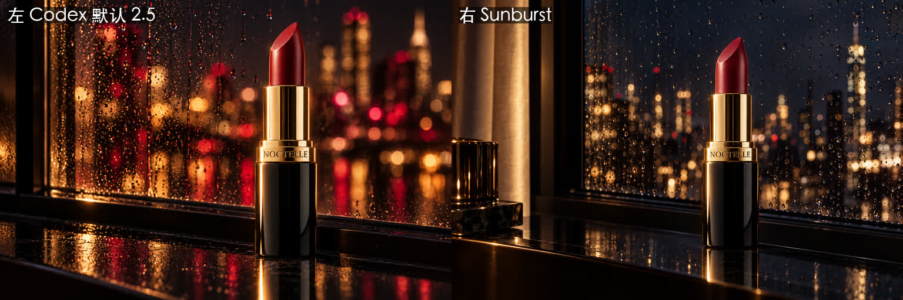
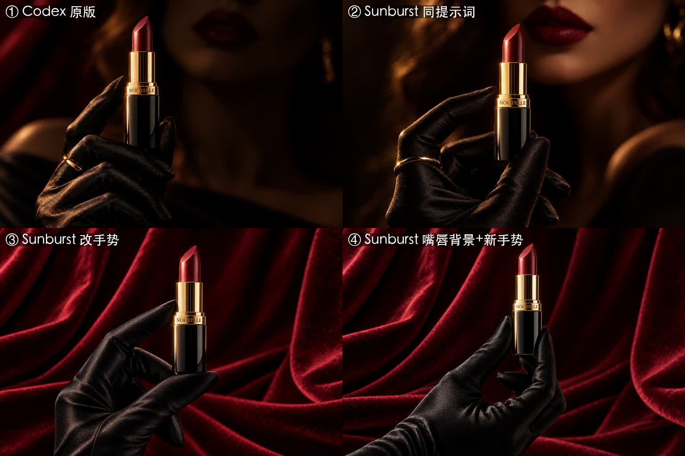
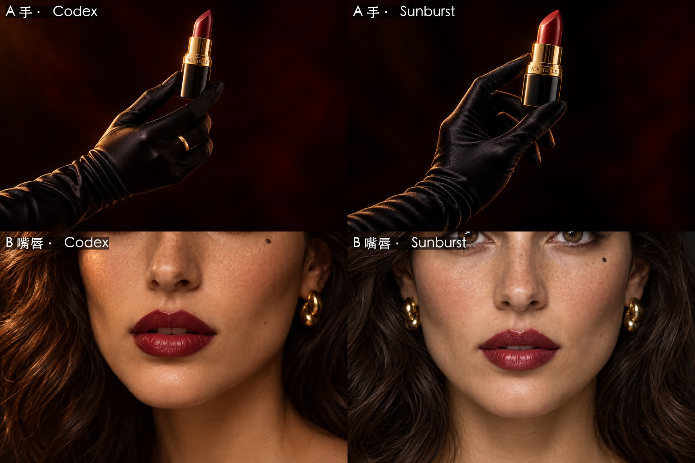

# 05 · 生图模型对比：Codex 内置 2.5 vs GPT Image 2.5 Sunburst

## 先搞清楚：我们一直在用的是哪个模型？
- OpenAI 在 2026-09-08 发布了 **ChatGPT Images 2.5**，同时推送给 ChatGPT 和 Codex 用户。
- API 里分成两个版本：**`gpt-image-2.5-flare`**（快）和 **`gpt-image-2.5-sunburst`**（更精细，生成更慢）。
- Codex 内置的生图工具**不能选模型**。有分析认为默认用的是 Flare。我们生成的 PNG 里，C2PA 元数据只写了 “ChatGPT / gpt-image”，看不出具体版本。
- Codex 自带的 imagegen skill 文档里，CLI 默认模型还写着 gpt-image-2，那份文档已经过时了。

## Sunburst 的接入过程（踩了一个坑）
1. 用 OpenAI 项目 key 调用，报错 `Project ... does not have access to model gpt-image-2.5-sunburst`
2. 一查才发现，这个项目只开放了一个文字模型；sunburst、flare、gpt-image-2 都被挡住了
3. **原因**：OpenAI 后台每个项目都有一张“允许使用的模型”清单（Project → Limits → Model usage）。把生图模型加进去，马上就通了
4. 还有一种可能会卡住：有些生图模型要求先做“组织认证”（Verify Organization）

## 价格：比网上估的便宜很多
官方按 token 计费：图片输出 $30 / 百万 token，图片输入 $8 / 百万 token。网上有人估算一张横图高质量要 $0.165，但我们**实测**：

| 尺寸 | 质量 | 参考图 | 输入 / 输出 token | 费用 |
|---|---|---|---|---|
| 1536×1024 | high | 1 张 | 1596 / 1372 | **约 $0.054** |
| 1024×1024 | low | 无 | 13 / 196 | 约 $0.006 |

也就是说，**$10 大约能出 180 张高质量横图**。脚本：[tools/sunburst.py](../tools/sunburst.py)

## 对比 1：S1 夜色窗台（同提示词、同参考图）

- **Codex 2.5（左）**：散景大、偏梦幻，酒红和金色守得很严，冲击力强
- **Sunburst（右）**：更写实、更锐利，窗上每颗雨滴、远处每盏灯都清楚；构图留白更有电影感。但它**自己加了一个小道具**，天空也偏冷蓝色
- 结论：Sunburst 没有碾压，只是细节和真实感高一档

## 对比 2：S3 黑缎手套（四个版本）

| 版本 | 结果 |
|---|---|
| ① Codex 原版 | **手势最自然**，氛围到位，细节差一口气 |
| ② Sunburst 同提示词 | **氛围感最好**：背景里虚化的酒红嘴唇和口红互相呼应，若隐若现。**但手很奇怪：那只手跟背后的人对不上，像是从别处伸进画面的，空间关系不成立** |
| ③ Sunburst 改手势 | 手是最优雅的一只，但背景变成了丝绒幕布，嘴唇和人都没了 |
| ④ Sunburst 嘴唇背景加新手势 | 想把 ② 和 ③ 合起来，翻车了：仍然是幕布，手指也扭曲 |

总指挥的判断：“换了生图模型以后，手势反而有一个很奇怪的特点：拿口红的那只手跟她本人不是对应的。但②确实是氛围感最好的一张，有那种若隐若现的感觉。反倒是 Codex 那版，手势很正常。”

### 为什么 ③④ 都变成了丝绒幕布
参考图用的是 P1 主视觉，**P1 的背景就是丝绒幕布**。走 images/edits 接口时，Sunburst 会把参考图的背景一起“学”走，哪怕提示词里写了“No velvet drape”也挡不住。
**规避**：参考图只给产品本身（裁掉背景，或者用黑底的 P2 微距）。

### 为什么 ② 的手跟人对不上
目前的推测是：画面里同时有“前景里的手”和“背景里虚化的脸”，模型分别把两者画得很好，却没有处理好**它们属于同一个身体**这层空间关系。可以试的修法：
- 让手和脸在构图上明确相连，比如画出手臂、肩膀
- 或者干脆分成两个镜头：一个拍手和口红，一个拍嘴唇

## 对比 3：S3 拆成两个镜头以后

总指挥选了“拆成两个镜头”：**A 只拍手拿口红**（手臂从画面左下伸进来，让手明确属于一条胳膊），**B 只拍嘴唇特写**。这回参考图换成了不带场景的：A 用黑底的 P2 微距，B 用模特正面 M1。

| | Codex 2.5 | Sunburst |
|---|---|---|
| A 手 | 手臂连贯，握法自然，**提示词里要的金戒指画出来了** | 握法更优雅，但戒指没了 |
| B 嘴唇 | **四分之三侧光，暖调，有广告感**；左眼下的痣在画面上沿 | 正脸、左右对称、均匀打光，**像证件照**：参考图 M1 的均匀光又被学走了 |

结论：
- **拆成两个镜头，“手和人对不上”的问题就消失了**
- 参考图的光也会渗进新图：用来锁长相的参考图如果是均匀光，出来的图就容易变平。需要戏剧光的镜头，要么换一张侧光的参考图，要么在提示词里把光写得更狠
- 这一轮 B 用 Codex 版，A 两版都能用
