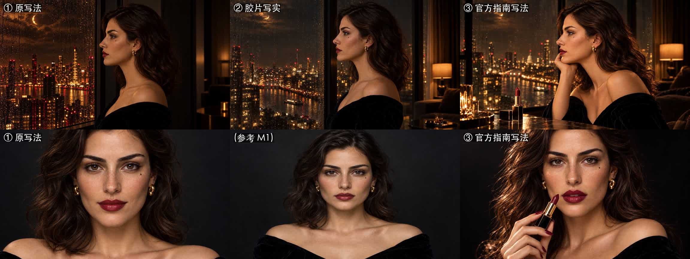
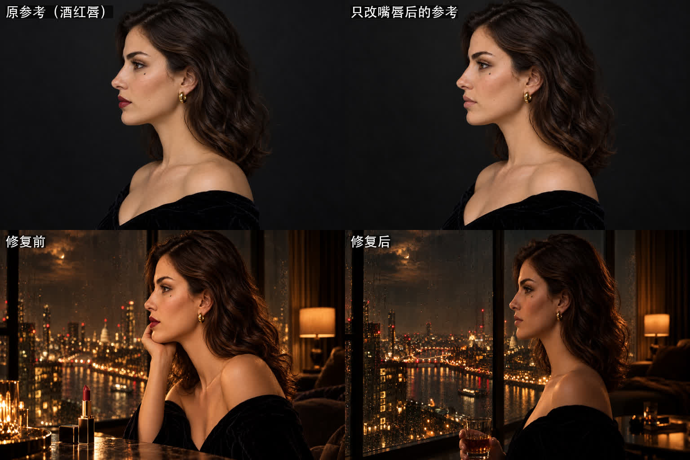

# 11 · GPT Image 2.5 写实提示词心得（官方指南 + 社区攻略 + 我们的实测）

> 起因：总指挥觉得我们的图“偏动画”，不像 AURA 那种“真人加特效”。查完官方指南才发现，**我们一直在用的那些词，恰恰是把画面推向 CG 的词。**

## 一、官方指南里最关键的几句

来源：OpenAI 的 [Image prompting](https://developers.openai.com/api/docs/guides/image-prompting) 和 [Cookbook 提示词指南](https://developers.openai.com/cookbook/examples/multimodal/image-gen-models-prompting-guide)

1. **要写实，就直接说**：photorealistic、a real photograph、taken on a real camera
2. **官方写实人像示例**里有一句：*avoid cinematic lighting, dramatic color grading, or stylized composition*，也就是**不要电影光、不要重调色、不要刻意的构图**；结尾再加 *No glamorization, no heavy retouching.*
   → 我们之前的提示词开头就是 “Cinematic still… luxury… chiaroscuro… strict palette”，**正好全踩中**
3. **相机和镜头参数只影响观感，不是物理模拟**：写 35mm、85mm 有用，但不能指望它真的算出景深
4. **结构**：场景 → 主体 → 细节 → 约束，用带标签的小段落来写，不要写成一长段
5. **参考图要编号并说明用途**：Image 1 是什么、起什么作用，Image 2 是什么、起什么作用，以及它们怎么组合
6. **跨图保持一致**：先做一张锚定图，每次都把它传进去，把定义特征重复写一遍，再加一句 *Do not redesign the character*
7. **改图要说“只改 X”**：*Change only X, keep everything else exactly the same*，并列出必须保持不变的东西
8. **质量档**：auto、low、medium、high、xhigh、max。先用 high，**只有不达标时才往上调**
9. **Sunburst 和 Flare**：Sunburst 是质量优先的基础模型，Flare 是速度优先的小模型。复杂的需求先用 Sunburst

## 二、社区攻略的补充

- “8K、hyperrealistic、raw” 这种堆砌词反而会出**蜡像脸**，因为模型会去模仿精修过的图库照片（[Atlas Cloud](https://www.atlascloud.ai/blog/tips/gpt-image-2.5-json-prompts-ugc-selfies)）
- **要瑕疵，不要“好皮肤”**：写“看得见的毛孔、细微的不对称、不要瓷娃娃磨皮”，比写 good skin 自然得多（[lifehackedai](https://lifehackedai.com/articles/anti-plastic-ai-image-method/)）
- **负面词控制在 3–5 个**：plastic skin、airbrushed、beauty-filter smoothing 之类，列太长反而没用（[Quest Studio](https://queststudio.io/blog/make-it-look-real-prompt-rules)）
- 删掉 flawless、airbrushed 这类“磨皮词”（[Prompt Architects](https://prompt-architects.com/blog/361-getting-realistic-skin-in-ai-images)）
- 中文实测文章也说：旧版那种很复杂的提示词，在新版里未必好用，简洁、结构清楚的写法更稳（[知乎](https://zhuanlan.zhihu.com/p/2081780392286230261)）

## 三、我们的实测（2026-10-22）



| 写法 | 结果 |
|---|---|
| ① 原写法（电影感、奢华、明暗对照、严格色板） | 像 CG 渲染：城市像数字绘画，皮肤光滑 |
| ② 胶片写实（摄影机和胶片型号、真实光源、瑕疵、写明“不是 CGI”） | 明显更像实拍，台灯这种真实光源出现了 |
| ③ 官方指南写法（分段结构、参考图编号、只改 X、不要美化） | 最像真人；姿态也更自然了（她托着下巴） |

**实测踩到的新坑：**

1. **参考图里的口红颜色会被带过来**。第一幕要素唇，但参考图里她涂着酒红色口红，提示词里写了 “IGNORE the lipstick” 也压不住。
   **解法**：用官方推荐的“只改 X”，先把参考图改成素唇版（*Change ONLY her lips: remove all lipstick… Keep everything else exactly the same*）。效果非常干净，人、光、构图一点没动。之后第一幕都用这张素唇参考图。

   

2. **USE 那一行会把产品“召唤”出来**。写了 “Keyframe for a lipstick commercial”，模型就在桌上、手里都塞了一支口红。
   **解法**：人物镜头的 USE 写成 “a short cinematic film”，再明确加一句 “No lipstick tube, no cosmetics appear in this shot”。

3. **模型会自己加道具**：手里多了一杯威士忌、桌上多了蜡烛。
   **解法**：写清楚手在哪里（“her hands are not in frame” 或 “her hands rest empty”），再加上 “No props other than…”。

4. **环境参考图里的地标也会传染**。窗景参考图画出了一座像圣保罗大教堂的穹顶，之后用它当参考的每一张图都带着这个穹顶，哪怕提示词里写了 “no domes”。
   **解法**：先把环境参考图本身重画成没有地标的虚构城市，源头干净了，后面才干净。

## 四、我们的新模板

```
USE: Keyframe for a short cinematic film; it will be animated by a video model. Landscape 16:9.
     （产品镜头才写 commercial；人物镜头写明 No lipstick / cosmetics appear）

SCENE: 时间、地点、光源（只写真实的光源和方向）、天气，城市要写 fictional、no landmarks

SUBJECT: Image 1 = 谁，起什么作用（identity reference ONLY），Do not redesign her.
         Image 2 = 什么，起什么作用（environment reference）
         要忽略参考图里的什么（IGNORE the studio lighting of Image 1）
         服装、妆容（这一镜嘴唇是什么状态）、视线、手放在哪里

DETAILS: 光打在哪一侧、哪一侧落进阴影；镜头焦段、机位、景深、焦点在哪里

CONSTRAINTS: Photorealistic, a real photograph taken on a real camera; 35mm film, fine grain.
             真实的皮肤纹理：毛孔、细绒毛、轻微的不对称、碎发
             No glamorization, no heavy retouching, no beauty-filter smoothing, no CGI look.
             No extra people, no props other than …, no text, no logos.
```

**颜色怎么办**：生成的时候让光保持自然、物理上说得通，酒红、黑、金的色板留到**后期调色**时统一。官方指南明确说，“戏剧化的调色”会让画面失真。
