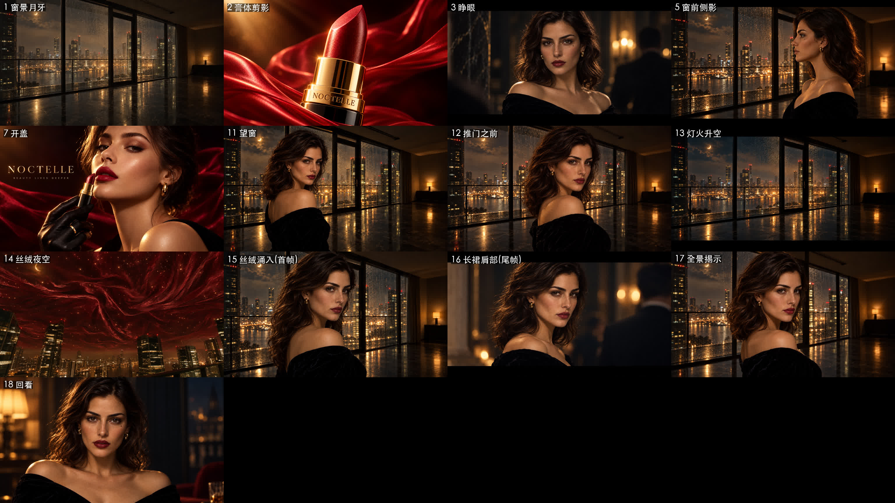
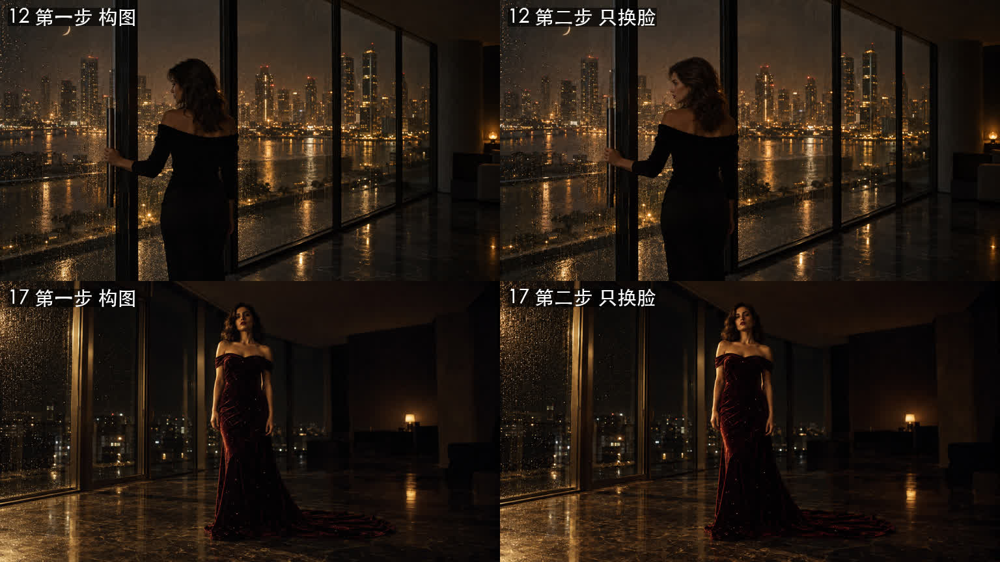
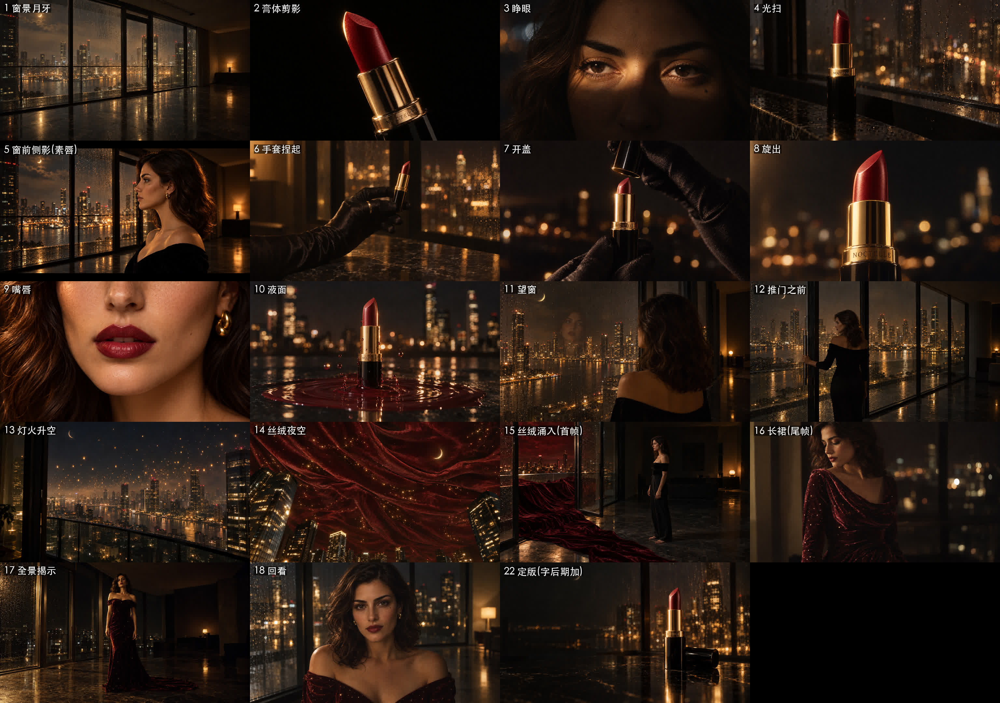

# 12 · 两步法：写实关键帧 v3 是怎么画出来的

> 接 [11 · 写实提示词心得](11-GPT-Image-2.5写实提示词心得.md)。这一章记录：按新模板画的第一批为什么大面积翻车，以及最后管用的“两步法”。

## 第一次尝试：新模板加参考图，13 张里只有 3 张能用

- **人物镜头几乎全是同一个姿势：回头看镜头**。要她看窗外、要她推门、要她看丝绒涌进来，全部被画成了回头看镜头
- **灯火升空**：基本原样复制了窗景参考图，灯火一盏也没飞起来
- **开盖**：被画成了带标语 “BEAUTY LIVES DEEPER” 的**海报**，这句标语我们从来没写过
- 有两张的背景里莫名多出一个男人

### 原因
`images/edits` 这个接口会把**第一张参考图当成“要修改的底图”**：
- 模特参考图（四分之三侧面）本身就是回头看镜头的姿势，所以每一张都长出了这个姿势
- 环境参考图被当成底图原样保留，画面里要求的变化没有画出来
- USE 那一行写了 “commercial”，模型就自动排成了一张广告海报

**参考图锁住的不只是长相，构图和姿势也一起被锁死了。**

## 两步法 ✅

1. **第一步：只用文字画构图（generations，不带参考图）**
   把镜头、机位、动作、光写清楚。人物先写成一个笼统的描述：“一位二十多岁的女性，深棕色波浪发，橄榄色皮肤”。
2. **第二步：只换脸，或者只换口红（edits）**
   把 [第一步的图, 身份参考图] 一起传进去：
   > Edit Image 1. Change ONLY the woman's face and hair so that she is exactly the woman in Image 2 … Keep everything else in Image 1 exactly the same: her pose, body, hands, clothing, lip color, framing, camera angle, lighting … Do not change anything else.

   产品镜头也是同样的思路，第二步改成“只换口红”，用 P2 当口红参考，保证刻字和膏体形状一致。

两张测试图里，第一步把构图和动作画对了（她背对镜头手搭在门把手上；她穿着长裙站在暗房中央），第二步只换了脸，其他一点没动。

## 又遇到一次内容审核拦截
“肩膀和锁骨的特写 + 露肩长裙”这个镜头（16），提示词在第一步就被 OpenAI 的安全系统拦下了（`moderation_blocked`）。
**改法**：换成“腰部以上的中近景”，长裙改成长袖、垂坠领口，镜头焦点放在丝绒的褶皱上。改完以后两步都通过了，画面反而更优雅。
**教训**：真人风格的图里，不要把镜头对准裸露的身体部位，尤其是第二步还要换脸的时候。

## 地标又冒出来了
液面那张（10）的提示词里忘了写“没有地标”，背景里又出现了一座穹顶。补上 “modern glass towers only, no domes, no cathedrals, no landmarks” 后重画，问题解决。
**每张图的提示词都要单独写清楚，不能指望别的镜头里写过的约束会自动带过来。**

## 结果：完整的写实分镜 v3

> ⚠️ 这一版后来又做了一轮连续性修正，最终版见 [13 · 连续性检查](13-连续性检查.md)。

- 19 张关键帧（第 19–21 镜的快闪从这些素材里剪），全部是同一个房间、同一座城、同一个人、同一支口红
- 第 9 镜嘴唇沿用了之前 Codex 画的那张（本来就够写实）
- 第 22 镜定版：左边留出空位，广告语后期再加

## 费用
这一章的出图（第一批 13 张，加两步法 30 次左右的调用）一共约 **$1.5**。Sunburst 的总花费累计约 **$2.6**，10 美元的预算还剩一大半。
