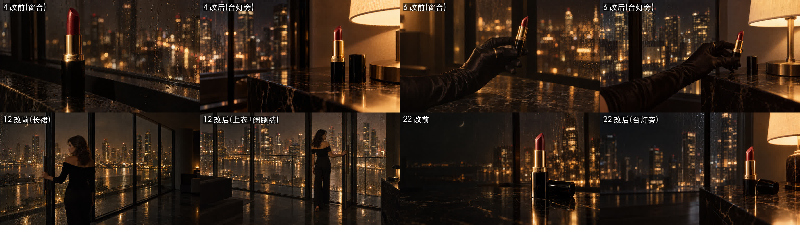
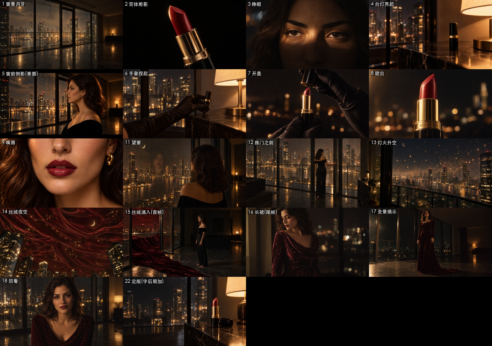

# 13 · 连续性检查：一个房间、一套衣服、一支口红

> 起因：总指挥问“这个液面想表达什么？”，接着又指出**“第 4 镜有点割裂，像有两个窗户一样”**。一查，确实是个真问题。

## 发现的穿帮

| # | 穿帮 | 谁发现的 | 改法 |
|---|---|---|---|
| 1 | 房间设定是一整面**落地玻璃墙**，根本没有“窗台”，可第 4、6、10 镜都把口红放在一个带雨痕的“窗台”上，**看起来像有两种窗户** | 总指挥 | 口红改放在**台灯旁边的黑色大理石矮柜**上（总指挥的主意：台灯是屋里唯一的光，口红就该在它旁边） |
| 2 | 第 10 镜“液面”在故事里不承担任何推进作用，是从口红广告的惯例里搬来的；它的“预兆”改法又要依赖窗台 | 总指挥提问，导演承认 | **砍掉**，省下的时间留给第三幕的变形 |
| 3 | 第 4、6 镜里口红已经开着盖，第 7 镜才是“开盖” | 导演 | 用“只改 X”把这两张改成**盖着盖子**的口红，并去掉多出来的盖子 |
| 4 | 第 12 镜她穿黑色长裙，第 15 镜却是上衣加裤子 | 导演 | 统一成**黑丝绒露肩上衣 + 黑色阔腿裤 + 赤脚** |
| 5 | 第 16 镜的酒红长裙是长袖（因为审核改过），第 17、18 镜却是露肩款 | 导演 | 17、18 也改成**长袖、垂坠领口** |

## 连续性规矩（以后每张图开画前先对一遍）

**房间平面**
- 北面：一整面落地玻璃墙，中间有一扇玻璃阳台门。雨后玻璃上全是雨痕，窗外是虚构的现代城市（只有玻璃高楼，没有任何地标），左上方挂着一弯金色月牙
- 东面（画面右侧）：一个**黑色大理石矮柜**，带金色纹路，紧挨着玻璃墙的转角，柜上放着**唯一的光源：一盏暖色台灯**，奶白色灯罩
- 地面：深色抛光石材，倒映着城市灯光
- **没有窗台**

**口红的状态**（按镜头顺序）
1. 盖着，立在台灯旁的矮柜上（4）
2. 盖着，被戴手套的手捏起来（6）
3. 揭开盖子（7）
4. 膏体旋出（8）
5. 涂完以后，开着立在矮柜上，盖子躺在旁边（22）

**她的服装**
- 第一、二幕：黑丝绒露肩上衣、黑色阔腿裤、赤脚、小金耳环；第一幕**素唇**，第 9 镜以后是**酒红唇**
- 第三幕变形以后：**酒红丝绒长裙**，长袖、垂坠领口，裙上缀着金色星点，拖尾
- 手套只在第 6、7 镜的手部特写里出现

**光**
- 屋里只有台灯一个光源，其余全部来自窗外的城市
- 色板留到后期调色时统一

## 修正后的完整分镜 v3.1（18 张关键帧）

## 教训
- **每一张图都要放回“同一个空间”里去检查**：东西在房间的哪里、光从哪里来、她穿的是什么、口红是开着还是盖着
- 单张好看不等于能用。这次几张“窗台口红”单看都很漂亮，放进故事里却是穿帮
- 总指挥看片子是用“生活常识”在看（这个家有没有窗台？口红该放在哪？），这一点 AI 和导演都容易忽略
