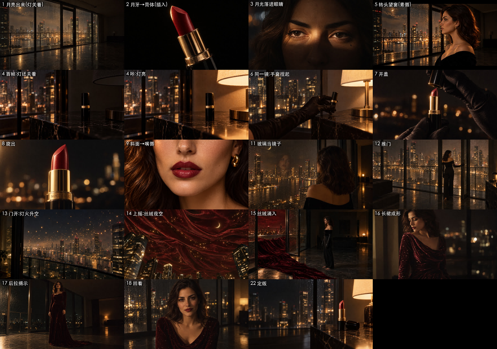

# 14 · 转场与运镜设计：每两镜之间是怎么接上的

> 起因：总指挥问“**3 到 5 之间你打算怎么处理？**”他说的是导演最核心的一件事：
> “不用每一张都用图片生成，但我们心里一定要知道这个运镜该怎么运。抱着这样的想法去审视每一张图片，这样才会有故事感。”
>
> 按这个思路把整条片子从头“走”了一遍，3 到 5 之间一下子查出三个硬伤。

## 一、3 到 5 之间的三个硬伤

1. **空间在来回跳**：第 4 镜在台灯旁 → 第 5 镜在窗前 → 第 6 镜又回到台灯旁。她在房间里来回走，镜头只是跟着跑，没有理由
2. **台灯是谁开的**：第 4 镜写的是“台灯刚亮”，可画面里没有任何人；更糟的是，第 1、5 镜里台灯**本来就亮着**
3. **手套从哪来**：第 6、7 镜她戴着黑缎长手套，第 12、15 镜的手却是光着的

## 二、改法

**顺序调整为：3 → 5 → 4 → 6**，让她的动线变成“窗前 → 走几步 → 窗边转角的矮柜”，一路往前走，不再回头。

| 衔接 | 手法 | 具体怎么接 |
|---|---|---|
| 1 → 2 | **形状匹配剪辑** | 云层散开，露出一弯金色月牙；月牙的弧线切到膏体斜面的金边，同一道弧（0.6 秒的“隐喻插入”，不是真实时间） |
| 2 → 3 | **光的接力** | 第 1 镜月亮出来了，月光穿过玻璃，正好落在黑暗中她的眼睛上。**是月光叫醒了她**，她睁开眼 |
| 3 → 5 | **动作匹配剪辑** | 第 3 镜结尾，她的头开始转向窗外；第 5 镜从转头的半途接上，停在侧脸。两镜里那道光都横在她眼睛上，观众感觉是同一个动作 |
| 5 → 4 | **声音先进（J-cut）** | 还停在第 5 镜她侧脸的时候，先听到“**咔**”一声，是台灯开关的声音；然后切到第 4 镜，黑暗里台灯亮起来，口红被照亮 |
| 4 → 6 | **一镜到底** | 同一个镜头：戴手套的手开灯 → 光铺满大理石 → 同一只手捏起口红。用 H3 的首尾帧模式：首帧是灯还关着，尾帧是手套捏起口红 |
| 6 → 7 | **沿轴推近** | 她捏起口红抬到胸前，切到微距，正好揭开盖子：“**咔**” |
| 7 → 8 | **一镜到底** | 盖子离开，膏体缓缓旋出 |
| 8 → 9 | **形状匹配剪辑** | 膏体的斜面 → 她嘴唇的弧线，嘴唇已经是酒红色。“涂”这个动作留给观众自己补 |
| 9 → 11 | **动作动机** | 她抿了一下嘴唇（涂完口红的习惯动作），抬眼。屋里没有镜子，**夜里的落地玻璃就是她的镜子**：她看玻璃里的自己，倒影旁边就是那弯月牙 |
| 11 → 12 | **动作切** | 她转身走向阳台门，戴手套的手搭上把手 |
| 12 → 13 | **因果** | 门推开，风和声音灌进来，**城市的灯火开始往上飘**：她一开门，夜就有了回应 |
| 13 → 14 | **一镜到底：上摇** | 镜头跟着升起的灯火往上摇，天空变成酒红丝绒 |
| 14 → 15 | **反打** | 切回屋里：她已经退回房间中央，丝绒从门口淌进来，流到她赤着的脚边 |
| 15 → 16 | **沿轴推近** | 丝绒漫上她的身体；推到腰部，在她身上收拢成长裙（首尾帧：第 15 镜 → 第 16 镜） |
| 16 → 17 | **一镜到底：后拉** | 镜头从腰部慢慢后拉到全景，她转身面向房间；窗外的天空空了，星星都在她的裙子上 |
| 17 → 18 | **沿轴推近** | 切到近景，她看向镜头，淡淡一笑 |
| 18 → 19–21 | **加速快闪** | 金色月牙 / 酒红嘴唇 / 裙上的星点，每刀 0.4 秒 |
| 21 → 22 | **定版** | 口红回到台灯旁的矮柜上，音乐静一拍，一只手入画把盖子扣上：“**哒**” |

**声音的“咔哒”变成了三次**：
- 开灯的“咔”：夜开始
- 开盖的“咔”：仪式开始
- 合盖的“哒”：故事结束

三次都是同一种干脆的机械声，首尾闭环。

## 三、为这个修了哪些图（全部用“只改 X”）

| 镜 | 改动 |
|---|---|
| 1、5 | **台灯改成关着**，屋里只剩窗外的光 |
| 4 | 另做一张“灯还关着”的首帧，当一镜到底的开头 |
| 12、15 | **补上黑缎长手套**，和 6、7 一致；手套一直戴到第三幕变形，变形时连同衣服一起变成长裙 |

## 四、方法论（总指挥教的）
1. **先在心里把整条片子“走”一遍**：谁在动，往哪动，为什么动，光从哪来，声音什么时候进
2. **转场要有理由**：动作、视线、光、声音、形状，至少占一样
3. **不是每一帧都要出图**：一镜到底、推拉摇移的中间过程，交给视频模型的首尾帧去完成；图片只负责“起点”和“终点”
4. **审每一张图时都问一句**：它能接上前一镜吗？能接上后一镜吗？
