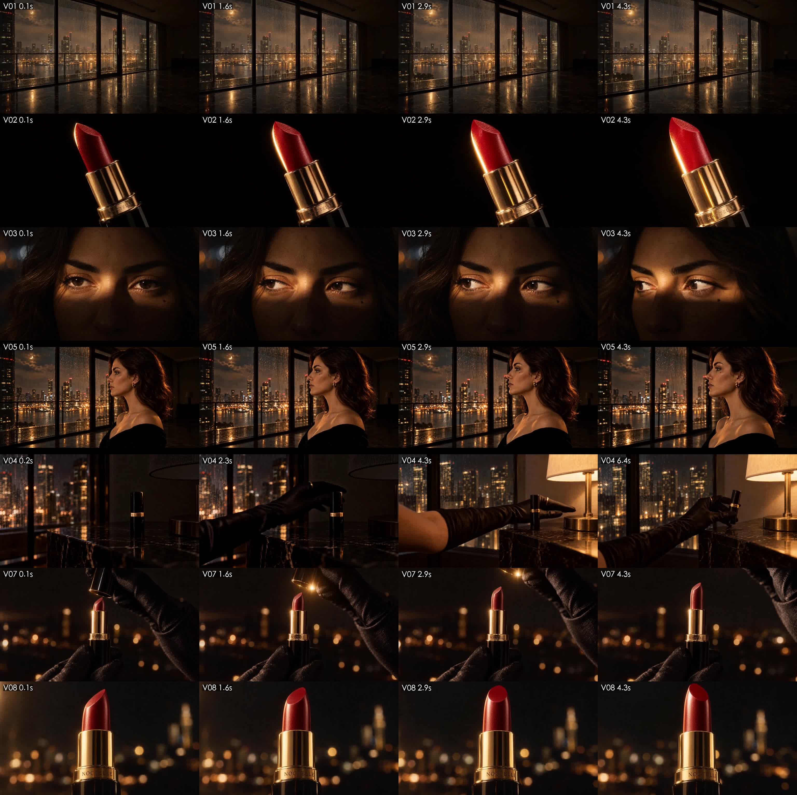
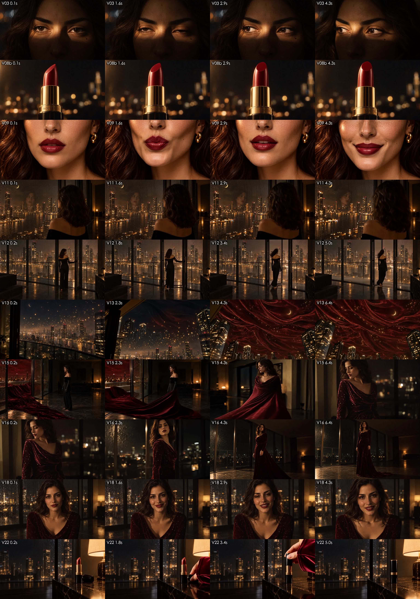

# 15 · MiniMax H3 出片与粗剪 v1

> 成片：[粗剪_全片_v1.mp4](../assets/05-video/粗剪_全片_v1.mp4)，34.7 秒，1344×768。声音用的是 H3 自带的环境声，还没有配乐，也还没调色。

## 接入官方 API（v2）
- 创建任务：`POST https://api.minimax.cn/v2/video_generation`，请求体包含 `model`（MiniMax-H3）、`content` 数组、`resolution`（768P）、`duration`（4–15 秒）
- `content` 里放一项 `text`，再加 `image_url`，`role` 取 `first_frame` 或 `last_frame`（首尾帧），或者 `reference_image`（参考图，最多 9 张）。**首尾帧和参考图不能混用**
- 查询任务：`GET /v2/query/video_generation/{task_id}`，成功后从 `task.content.url` 下载
- 提示词按官方 skill 的 I2VA / FL2VA 格式写：第一行写图片和时间点怎么对齐，下面三段是 `integrated_multimodal_description` / `overall_soundscape` / `non_diegetic_music`
- 脚本：[tools/minimax_video.py](../tools/minimax_video.py)（提交 → 轮询 → 下载 → 记账），[tools/run_all.py](../tools/run_all.py)（按 manifest 三路并行）

## 出片结果（17 条成功，按刊例价约 ¥39）

| 镜头 | 结果 |
|---|---|
| 4→6 一镜到底（首尾帧） | 🌟 黑暗中戴手套的手开灯，灯亮以后顺手捏起口红，完全照着设计走 |
| 13→14 灯火上摇（首尾帧） | 🌟 灯火往上飘，镜头上摇，天空变成丝绒 |
| 15→16 丝绒成裙（首尾帧） | 🌟 丝绒涌进来、裹住她、变成长裙，最难的一镜成功了 |
| 16→17 后拉揭示（首尾帧） | ✅ |
| 22 定版 | ✅ 穿着丝绒袖子的手入画，合上盖子 |
| 2 膏体剪影 | ✅ 金光沿着斜面的边缘走过去，像在画一弯月牙 |
| 3 睁眼 | ⚠️ **两次都看向了画面右边**，写明 “screen left” 也没用。最后在剪辑里把下一镜（5）**镜像翻转**，让视线方向对上 |
| 12 推门 | ⚠️ 她推开门以后**自己走到了阳台上**（剧本里没有这一步），所以剪在她迈步之前 |
| 8 旋出 | ⚠️ 膏体几乎不动，重拍了一次也只多了一点 |

**经验：**
- **首尾帧是最强的武器**：所有转场和变形，只要有起点图和终点图，H3 都能把中间补得很好
- 4 秒一条大约 2 分钟出片；三路并行，14 条大约 15 分钟跑完
- 模型对“画面左右”的理解不可靠。方向出错时，剪辑里镜像翻转是零成本的补救（前提是镜头里没有字，也没有能看出左右的标志）
- 模型会给动作“加戏”（她自己走出了门）。剪辑时只取需要的那一段

## 计费上的一个坑
- 第一次充值充成了“套餐补充”余额，按量余额不够，8 条任务被拒（错误码 1008 insufficient balance，被拒不扣费）
- 套餐 key（`sk-cp-` 开头）调用 H3 视频接口是**能用的**（实测成功）。客服说不需要订阅套餐也能用补充余额；不过免费查询接口 `/v1/token_plan/remains` 返回的是“no active token plan subscription”。两边说法不一样，以控制台的实际扣费为准

## 剪辑（粗剪 v1）
[tools/cut_v1.py](../tools/cut_v1.py) 用一张 EDL 表（文件、入点、出点、额外滤镜）描述整条片子，再用 ffmpeg 一次拼出来：
- 第 5 镜做了镜像，还裁掉了这条自带的上下黑边
- 片尾用 Didot 字体打上 “Wear the” 和 “Night.”，白色和酒红色先后淡入
- 三刀 0.4 秒的快闪，取自膏体、嘴唇和裙上的星点

## 还没做
- 配乐（约 96 BPM 的暗调电子乐），然后按节拍重新卡点
- “咔”“哒”三次音效的统一处理，第 5→4 镜开灯声先进（J-cut）
- 整体调色，统一成酒红、黑、金
- 竖屏 9:16 版
