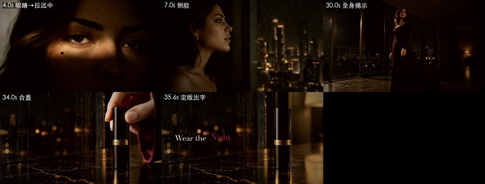
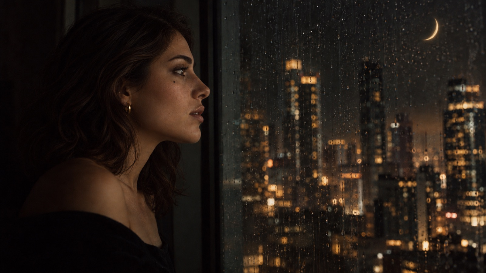
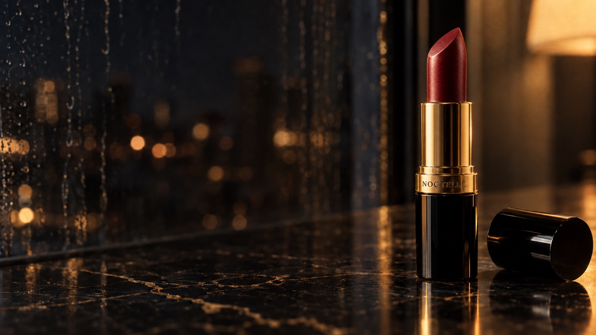
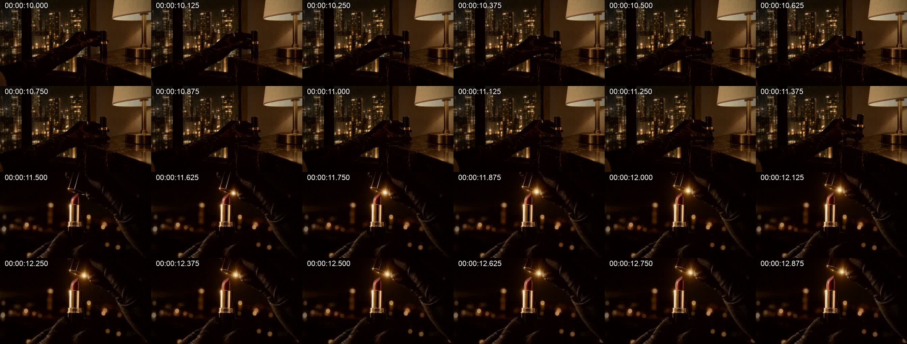
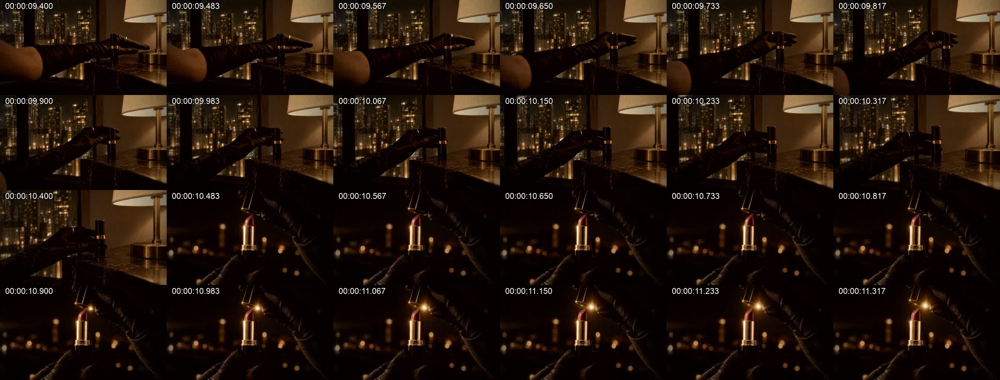

# 17 · 剪辑 v3：3→5 合成一镜，结尾改成“后拉 → 合盖”

> 总指挥看完 v2，指出了两处问题：
> 1. **结尾**：“第一张图片（全身后拉），然后突然就过渡到半身像了，然后给了一个口红，然后又给了一个嘴巴的特写，然后就是拿盖子装上，就感觉差点意思。”他要的是：**镜头拉远切到人的全身之后，然后再直接切到那个手拿着盖子给它盖上盖，啪嗒一下。那个镜头要贴近一点，构图要好。**
> 2. **3 到 5**：“3 太惊艳了，就衬托的 5 就感觉差点意思了。”

成片：[粗剪_全片_v3.mp4](../assets/05-video/粗剪_全片_v3.mp4)（36.5 秒，压缩版 13.3MB）

## 一、3 → 5：两镜合成一镜

**问题出在哪**：第 3 镜（眼睛特写）是整片最好的一镜，下一刀切到第 5 镜（窗前侧影），景别、质感都掉了一级。v2 里第 5 镜还做了镜像翻转，才让视线方向对上；画面被裁过、翻过，质感自然又差了一截。

**改法：不切了，一镜到底。** 用 H3 的首尾帧模式（FL2VA）：
- **首帧**：第 3 镜的眼睛特写（S03_B）
- **尾帧**：新做的一张侧脸（K05_侧脸_B，85mm，她面朝**右边**的落地窗，窗光在额头、鼻梁、嘴唇上勾出一道亮边，右上角是金色月牙）
- **中间交给模型**：她眨眼、对焦，头转向右边，镜头同时**大幅度慢速后拉并向她右侧环绕**，把落地窗和月牙“揭”出来

这样第 3 镜的惊艳一直延续到侧脸，中间没有落差；而且转头这个动作本身就成了转场的理由。

| 关键帧 | 提示词 |
|---|---|
|  | 构图：[K05_侧脸_A构图.txt](../prompts/04-lipstick/v3/K05_侧脸_A构图.txt)；第二步换脸（两步法，见 [12](12-两步法与写实关键帧v3.md)） |

视频提示词：[V03_05_睁眼拉远.txt](../prompts/05-video/V03_05_睁眼拉远.txt)（6 秒，首尾帧）

**写这类提示词的要点**：
- 开头写清楚“两张图分别对齐 0 秒和 6 秒”，这是官方 FL2VA 的格式
- 镜头运动要写**幅度和速度**（“large amplitude at slow speed”），不写的话模型常常只是轻轻推一下
- **方向要写死**：“turns her head to the RIGHT”“facing the right side of the frame”。v1 里这一镜她两次都往左看，视线接不上后面的镜头
- 素唇要再强调一遍（“no lipstick appears”）：这时候她还没涂口红

## 二、结尾：全身后拉 → 直接切 → 合盖近景

**v2 的结尾**：全景揭示 → 半身回看 → 三刀快闪（膏体 / 嘴唇 / 丝绒）→ 远景定版 + 手入画合盖。

总指挥说得对：后拉到全身是整片情绪最高的地方，后面又塞了**四个不同的景别**，情绪被切碎了；定版那一镜又太远，合盖的动作看不清，“啪嗒”没有力量。

**v3 的结尾**：
1. **后拉揭示**一直拉到全身（多留 0.6 秒，让观众看清裙子和窗外空掉的天空）
2. **硬切**到一个**贴近的产品近景**（K22_定版近景_B，100mm，与大理石台面齐平，口红立在画面右三分之一，盖子横躺在旁边，左边 45% 留给文案）
3. 一只穿酒红丝绒长袖的手从右边入画，拿起盖子扣上：“**啪嗒**”，手退出
4. 画面定格，“Wear the Night.”依次淡入

| 关键帧 | 提示词 |
|---|---|
|  | 构图：[K22_定版近景_A构图.txt](../prompts/04-lipstick/v3/K22_定版近景_A构图.txt)；第二步换口红（两步法） |

视频提示词：[V22b_合盖近景.txt](../prompts/05-video/V22b_合盖近景.txt)（5 秒，图生视频；写明“1.00 秒手入画、约 2.60 秒盖子扣上”）

**为什么是硬切，不是叠化**：全身的“大”和产品近景的“小”反差越大，那一声“啪嗒”越干脆。叠化会把这种反差抹掉。

**连续性**：手是**光手 + 酒红丝绒长袖**。第三幕手套已经和衣服一起变成了长裙，所以这里不能再戴手套。

**删掉了什么**：第 18 镜（回看）和三刀快闪。不是它们不好，而是放在这里打断了情绪。

## 三、剪辑脚本的变化（[tools/cut_v3.py](../tools/cut_v3.py)）
- EDL 从 18 段减到 13 段，总长从 34.8 秒变成 36.5 秒（多出来的是定格出字的 1.4 秒）
- 新增 `TEXT:秒数` 写法：在最后一段末尾用 `tpad=stop_mode=clone` **定格**这么多秒，文案在定格时淡入；定格时长也算进这个块的长度，时间线不会错位
- 合盖那段声音 +4 dB，让“啪嗒”站出来

## 三点五、v3.1：只修 11~12 秒那一刀

> 总指挥看完 v3：“11~12 秒的过渡，我觉得可以用一些剪辑的手法去稍微弥补一点，还是说就不动？”

v3.1 成片已被 v3.2 取代（仍在 git 历史里）。改前改后对比：[对比_11秒_改前改后.mp4](../assets/05-video/对比_11秒_改前改后.mp4)

**逐帧看出来的问题**（改前，每格 1/8 秒）：

1. **死时间**：用 motion.py 量了一下，手在 V04_06 的 5.25 秒就捏住了口红，之后动作值一直在 0.2 左右，几乎不动。可 v3 剪到 6.3 秒才切，等于**有 1.2 秒画面停在那里**
2. **少了一拍**：上一镜口红还立在台面上，下一镜盖子已经离开膏体。“拿起来”和“拔盖”这两个动作都没拍到，所以接得像跳了一下
3. **开盖的“咔”被切掉了一半**：V07 自己的开盖声在 0.3 秒，v3 的入点正好也是 0.3 秒，加上 80 毫秒的淡入，这声“咔”被削弱了

**结论：要动，但不用重拍，剪辑就能补。** 三招都是剪辑的老规矩：

| 招 | 做法 |
|---|---|
| **动作一完成就切** | V04_06 出点从 6.3 提前到 5.35 秒，手指刚捏住就切走，死时间没了，片子短了 0.7 秒 |
| **切之前加速推近** | 最后 1 秒加数码推近（1.0 → 1.35 倍，ease-in 越推越快），锚点在画面右边缘，推的过程中口红从画面 67% 的位置移到 60%，靠近下一镜口红的位置（48%），眼睛不用跳太远。推近给了这一刀“冲进去”的动势，也正好是 docs/14 里原本设计的“沿轴推近” |
| **用声音补上少的那一拍** | V07 入点改到 0.05 秒，盖子刚离开膏体；开盖的“咔”落在切点后 0.26 秒。观众先看到手捏住，再听到“咔”、看到盖子离开，脑子会自己补上“她拔开了盖子” |

改后（每格 1/12 秒，10.44 秒处切）：

**数码推近怎么做才不抖**（[tools/cut_v3_1.py](../tools/cut_v3_1.py) 里的 `PUSH:开始秒:最终倍数`）：zoompan 的坐标只能取整数像素，直接推会一顿一顿地抖。先把画面放大到两倍（lanczos），再用 zoompan，取整误差就减半，肉眼看不出来。1.35 倍以内画质没有明显损失，胶片颗粒也能盖住一点软。

### v3.2：加速推改成缓推

> 总指挥看完 v3.1：“那个推进，我觉得稍微再慢一些些。因为我们这个主题就是比较舒缓，这里稍微快速的推进显得有一些着急了。就一个镜头缓慢地贴近，当然也不能太缓慢，就缓缓的。”

他说得对。**加速推进是快节奏广告的语法**（汽水、运动品牌那种冲进下一镜的劲），放在这条“夜慢慢降临”的片子里就抢拍了。我只想着“要给切点动势”，没想到动势也有快慢，要跟着片子的调性走。

改法（[tools/cut_v3_2.py](../tools/cut_v3_2.py)）：
- **推的时间拉长**：从最后 1 秒推，改成整个镜头 2 秒都在推，从台灯亮起就开始慢慢贴近
- **推的幅度变小**：1.35 倍 → 1.22 倍。平均速度从每秒 0.35 倍降到每秒 0.11 倍，大约只有原来的三分之一
- **速度曲线改了**：原来是越推越快（ease-in 二次曲线），现在是前 25% 柔和起步、之后**匀速**。切的时候镜头还在慢慢往前走，不会停住，也不会冲
- 出了两档给总指挥挑：A 1.15 倍（更慢），B 1.22 倍（默认）。对比：[对比_推近速度_三档.mp4](../assets/05-video/对比_推近速度_三档.mp4)

成片：[粗剪_全片_v3.2.mp4](../assets/05-video/粗剪_全片_v3.2.mp4)（35.8 秒，用的是 B）

**学到的**：运镜的速度也是调性的一部分。舒缓的片子，推、拉、摇都用匀速或柔和的起止；加速推、甩镜头这类“冲”的手法，只留给快节奏的片子。

**如果剪辑还是补不上**：B 方案是补拍一条 H3 首尾帧（V04_06 的最后一帧 → V07 的第一帧），让她真的把口红拿起来、拔开盖子，约 ¥2~3。

## 四、花费
- 新关键帧 2 张（各 A/B 两步）：Sunburst 约 $0.25
- 新视频 2 条（6 秒首尾帧 + 5 秒图生视频）：按刊例价约 ¥5.5，走套餐 key
- 到 v3 为止 H3 一共出片 19 条，按刊例价约 **¥44.5**

## 五、还没做的
- **配乐**：大约 96 BPM 的暗黑极简电子，按节拍重新卡点
- **三次“咔哒”音效**：开灯、开盖、合盖，做成同一种干脆的机械声，首尾呼应
- **竖版 9:16**：抖音投放用
