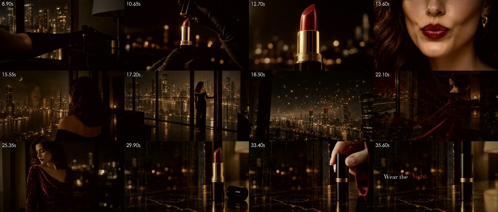
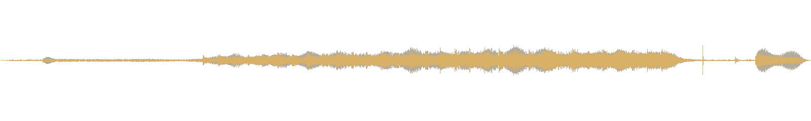

# 18 · 配乐与卡点 v4

> 总指挥定了 v3.2 的缓推用 B 档（1.22 倍），然后说：“开始做配乐卡点吧。”

成片：[NOCTELLE_Wear-the-Night_v4.mp4](../assets/05-video/NOCTELLE_Wear-the-Night_v4.mp4)（35.8 秒，−15.8 LUFS，真峰值 −2.3 dBFS）

> 这一版就是主线的**定稿**。配乐是导演用代码按画面“写”出来的（本来只打算当临时配乐，先把卡点和混音跑通），总指挥听完说“可以的，就这样”。
> 用 Gemini / Lyria 生成正式配乐的路线留在第一节，以后想换随时能换，按第五节的规则重新卡点就行。

## 一、配乐从哪来：先撞墙，再找轮子

| 方案 | 结果 |
|---|---|
| MiniMax 音乐接口（music-3.0，纯音乐） | **HTTP 410，状态码 2153**：2026 年 8 月 20 日起，付费音乐接口不再对新用户开放。按量 key 和套餐 key 都一样，没有扣钱 |
| 开源的 MiniMax-Music3 | 官方写明推理需要 CUDA；这台 Mac 是 M1 Pro、16GB，跑不了 |
| **Gemini App 里的 Lyria 3.5** | 总指挥有 Gemini 会员。2026 年 9 月以后的版本能选纯音乐，最长 3 分钟。**以后想换正式配乐，走这条路** |
| 导演自己合成配乐 | 本来只是临时配乐，用来跑通卡点、混音、音效的流水线；最后直接定稿 |

给 Lyria 的提示词：[L1_Lyria_夜色丝绒.txt](../prompts/06-music/L1_Lyria_夜色丝绒.txt)

```
Instrumental only, no vocals. A slow, dark, sensual score for a luxury lipstick commercial set in a rainy city apartment at night. Minimal cinematic electronic, about 92 BPM, steady 4/4 pulse, D minor.
[Intro] Near silence: a soft low analog drone, rain texture, one distant felt-piano note.
[Build] A deep warm sub-bass pulse on every beat like a slow heartbeat, tiny crisp ticking clicks as percussion, a warm synth pad slowly opening, a three-note felt-piano motif.
[Climax] Velvet strings and a low choir-like pad swell, lush and intimate; the pulse stays steady and never rushes.
[Ending] Stop cleanly on a downbeat, one beat of silence, then a single low resonant chord with a long dark reverb tail.
Elegant, nocturnal, mysterious, restrained. No drops, no EDM, no trap hi-hats, no guitar, no trailer hits.
```

中文对照：只要纯音乐。缓慢、暗调、性感，给雨夜公寓里的奢华口红广告用；极简电影感电子乐，约 92 BPM，稳定四拍，D 小调。【前奏】几乎无声：低频长音、雨声质感、远处一个毛毡钢琴单音。【铺垫】每拍一下的超低音像慢心跳，细小的滴答声当打击乐，合成器铺底慢慢打开，三个音的钢琴小动机。【高潮】丝绒般的弦乐和低沉的合唱感铺底涌起，律动保持稳定、不着急。【结尾】在强拍上干净停住，静一拍，然后一个低沉的和弦带长混响。优雅、夜晚、神秘、克制；不要 drop、EDM、trap 碎镲、吉他、预告片重击。

## 二、音乐和画面怎么对上（[tools/cut_v4.py](../tools/cut_v4.py)）

**三个锚点：**
1. **开灯的“咔”= 律动的第一拍**（8.96 秒）。前面 9 秒是月光、眼睛、侧脸，没有节拍，只有低频长音和雨声；灯一亮，心跳一样的低音从这一下开始。这就是 docs/14 里说的“夜开始”
2. **硬切到合盖那一刀 = 开灯后第 8 小节的强拍**（29.83 秒）。音乐在这一下**停住**，只剩混响尾巴慢慢散掉
3. **合盖的“啪嗒”在安静里响**（33.31 秒），最后一个低沉的和弦从这一声开始，垫在“Wear the Night.”下面直到结束

开灯到硬切正好 8 小节，速度就由画面算出来：**92.0 BPM**（和提示词里写的 92 一致）。

**其余的刀都吸附到八分音符上：** 从开盖那一刀开始，每一刀找最近的八分音符（每个八分音符 0.33 秒，所以最多挪 0.16 秒），挪的是**上一镜的出点**，后面的镜头整体跟着走；叠化取中点对拍；最后一刀对小节线。这次实际的挪动：

| 镜头 | 原来 | 吸附后 | 挪动 |
|---|---|---|---|
| 开盖 | 10.50 | 10.59 | +0.09 |
| 旋出（叠化） | 12.51 | 12.55 | +0.04 |
| 嘴唇 | 13.60 | 13.53 | −0.07 |
| 玻璃当镜子 | 15.43 | 15.48 | +0.05 |
| 推门（叠化） | 17.17 | 17.11 | −0.05 |
| 灯火上摇 | 18.53 | 18.42 | −0.11 |
| 丝绒成裙（叠化） | 21.88 | 22.00 | +0.12 |
| 后拉揭示（叠化） | 25.24 | 25.26 | +0.02 |
| 合盖（硬切） | 29.95 | 29.83 | −0.13 |

挪动都在 0.13 秒以内，肉眼看不出镜头变了，但每一刀都落在拍子上。用 librosa 检查：每一刀离最近的音乐起音都在 0.04 秒以内。

**踩的坑**：一开始时间线是按“出点 − 入点”算的，结果比实际渲染早了 0.15 秒，卡点全偏。原因是 trim 只保留时间戳落在 [入点, 出点) 里的帧，fps 滤镜在结尾还会再丢一帧。改成按 `ceil(出点×24) − ceil(入点×24) − 1` 帧来算，预测和实际一帧不差（脚本里会自动核对）。

## 三、临时配乐是怎么“写”的（[tools/temp_score.py](../tools/temp_score.py)）

全部用 numpy 合成，按卡点后的时间点现场生成，所以每个音乐事件都正好落在画面上：

| 层 | 什么时候 | 做法 |
|---|---|---|
| 低频长音 | 全程到硬切 | D2 + A2 锯齿波（加法合成，不混叠），低通随时间打开；开灯前压得很低 |
| 毛毡钢琴 | 膏体金边一闪落一个单音；开灯后第 2、4、6 小节弹三音动机 A–F–D | 几根略失谐的谐波，高次衰减更快，起音带一点闷的“噗” |
| 心跳低音 | 从开灯那一下起每拍一下，2、4 拍带一个轻的回跳 | 48Hz 正弦加音高下滑，叠二次谐波让手机喇叭也听得见 |
| 滴答 | 第 2 小节起，八分音符 | 2.5ms 的噪声脉冲过带通，正拍重、反拍轻，左右交替 |
| 合成器铺底 | 开灯后每 2 小节换和弦：Dm – B♭ – Gm – A | 低通从 500Hz 慢慢开到 2600Hz，丝绒涌入时开到最亮 |
| 弦乐 | 灯火上升开始涌，丝绒涌入到顶，后拉揭示时再推一点 | 高八度的和弦音，5.2Hz 揉弦（按相位积分，不然会变成怪异的调频） |
| 吸气 | 开灯前 1.3 秒 | 一段越来越响的噪声，“吸一口气”接上开灯 |
| 最后的和弦 | 从合盖“啪嗒”开始 | 低音 D 小调加两个钢琴音，长混响，片尾淡出 |
| 混响 | 全局 | 指数衰减的立体声噪声当冲激响应（RT60 约 2.8 秒），卷积 |

## 四、音效和混音
- **三声“咔哒”统一音色**：合盖那一声当母版，降 3 个半音轻轻叠在开灯上，升 2 个半音叠在开盖上（各 −10 dB）。三声各自保留原片的声音，只是加了同一个“底色”，听起来像同一家族
- **只留一个“啪嗒”**：合盖镜头里，拿盖子（原片 1.45 秒）、套盖子（2.89 秒）的声音和合盖一样响。音乐停住以后连响三下，“啪嗒”就不突出了。把 3.7 秒之前的原声压低 12 dB（50ms 斜坡放开），现在合盖比前两下响 9~12 dB
- **原声让路**：有了音乐以后，镜头原声整体让 3 dB（三声“咔哒”所在的镜头除外），雨声底子从 +6 dB 降到 +3 dB
- **响度**：−15.8 LUFS，适合手机外放。真峰值 −2.3 dBFS，给 AAC 编码的过冲留了余量（踩坑见 [06](06-踩坑清单.md) T10）





## 五、以后换配乐时怎么做
1. 用 librosa 测出 Lyria 那首的速度和拍点，找到“律动进来”的那个强拍，对齐开灯的“咔”
2. 网格换成音乐的拍点，同一套吸附规则重新卡点
3. 音乐在硬切那一刀快速收掉；把音乐自己的结尾和弦剪下来，放到“啪嗒”那一下
